# 🌊 The Vaavu Cave Tragedy (Maldives, 2026)

### Physics, geography and the chain of errors behind the worst diving accident in Maldivian history

> 🇪🇸 **[Versión en español](README.md)**

> **Popular-science study** · Author: Óscar Ramírez Martín · October 2026
> Based on cross-checked public sources and the author's own calculations.

> 📄 **PDF version:** [Study_Vaavu_Cave_Maldives.pdf](Study_Vaavu_Cave_Maldives.pdf)

> ⚠️ **A note of respect.** This study deals with the real deaths of six people: five Italian divers and a Maldivian military diver who died trying to recover them. It contains no photographs of the victims and no images of their bodies. The aim is to understand **why** it happened and **how it could have been prevented**, so that it does not happen again.

*Felidhoo, the capital of Vaavu Atoll, surrounded by reef and turquoise lagoon. The cave where the accident happened is about 14 km to the north. Photo: Ahmed Saffu, CC0, via Wikimedia Commons.*

---

## 📑 Contents

1. [Origin of this study](#1-origin-of-this-study)
2. [The case in 30 seconds](#2-the-case-in-30-seconds)
3. [Who they were](#3-who-they-were)
4. [The area: the Maldives, Vaavu and Alimathaa](#4-the-area-the-maldives-vaavu-and-alimathaa)
    - [4.6 What marine life you will find](#46-what-marine-life-you-will-find)
    - [4.7 The cave](#47-the-cave)
5. [Timeline](#5-timeline)
6. [What the images show](#6-what-the-images-show)
7. [Why they died: a point-by-point analysis](#7-why-they-died-a-point-by-point-analysis)
8. [The chain of errors](#8-the-chain-of-errors)
9. [How it could have been prevented](#9-how-it-could-have-been-prevented)
10. [The recovery and the sixth victim](#10-the-recovery-and-the-sixth-victim)
11. [Permits, responsibilities and investigations](#11-permits-responsibilities-and-investigations)
12. [Hypotheses: ruled out and still open](#12-hypotheses-ruled-out-and-still-open)
13. [Myths versus reality](#13-myths-versus-reality)
14. [Cross-checking sources: figures that do not match](#14-cross-checking-sources-figures-that-do-not-match)
15. [Technical glossary](#15-technical-glossary)
16. [Lessons for any diver](#16-lessons-for-any-diver)
17. [Method, limitations and confidence level](#17-method-limitations-and-confidence-level)
18. [Sources](#18-sources)
19. [Image credits](#19-image-credits)

---

## 1. Origin of this study

On 14 May 2026, five highly experienced Italian divers went down into an underwater cave in Vaavu Atoll, in the Maldives, and never came out. Two days later, one of the military divers trying to recover them also died. The press covered it with headlines such as "cave of death" or "sand trap".

This study does the opposite of a headline: it separates what is verified from what is assumed, explains the **physics and physiology** behind every technical term, and answers one specific question at each step: **how could it have been prevented?**

---

## 2. The case in 30 seconds

| Fact | Most reliable value |
|---|---|
| **Date** | Thursday 14 May 2026, dive starting around 11:00 |
| **Place** | Devana Kandu cave (also called Dhekunu Kandu, Thinwana Kandu or "Shark Cave"), next to Alimathaa island, Vaavu Atoll (Maldives) |
| **Coordinates** | 3°35′24″ N · 73°30′20″ E (approx.) |
| **Depth** | Entrance at ~47–58 m depending on the source; interior between ~60 and ~70 m |
| **Legal limit for recreational diving in the Maldives** | **30 m** |
| **Victims** | 5 Italian divers + 1 Maldivian military diver during the recovery |
| **Boat** | *MV Duke of York*, a Maldivian-flagged liveaboard dive cruiser |
| **Breathing gas** | Ordinary compressed air in 12 L cylinders, with no redundancy |
| **Medical cause** | **Anoxia** (lack of oxygen) in all five: they ran out of air inside the cave |
| **Probable cause** | They became disoriented on the way back, swam into a blind side tunnel that was not on any map and ran out of gas |
| **Who recovered them** | Three Finnish cave divers sent by DAN Europe, from 18 to 21 May |

**In one sentence:** a group of experts in **open-water** diving entered a dark cave at 60 m with recreational equipment and no guideline. On the way back they could not find the exit, and the air in a single cylinder lasts only a few minutes at that depth.

---

## 3. Who they were

| Name | Age* | Who they were |
|---|---|---|
| **Monica Montefalcone** | 51–52 | Associate professor of Ecology at the University of Genoa. She had spent years researching reefs in the Maldives. According to her husband, she had logged about 5,000 dives |
| **Giorgia Sommacal** | 20–23 | Montefalcone's daughter. She was not part of the research team |
| **Muriel Oddenino** | 31 | Marine biologist and researcher at the University of Genoa (DISTAV), certified divemaster |
| **Federico Gualtieri** | 30–31 | Recently graduated marine biologist (thesis on corals of the central Maldivian atolls), PADI instructor |
| **Gianluca Benedetti** | 44 | Diving instructor and the boat's operations manager; had lived in the Maldives since 2017 |
| **Mohamed Mahudhee** | 43 | Sergeant in the Maldivian Coast Guard (MNDF), one of its most experienced divers. He died on 16 May during the recovery |

*\*Ages vary between media outlets (see [§14](#14-cross-checking-sources-figures-that-do-not-match)).*

The group was on the University of Genoa's annual scientific expedition on soft corals, which had been running since 1997. The university maintains that this particular dive was **a personal activity**, outside the official programme.

> 🧠 **Reasoning:** "very experienced" ≠ "experienced in caves". 5,000 open-water dives do not teach the techniques a cave requires: guideline, rule of thirds, kicking without stirring up sediment, navigating in darkness. The specialists quoted by *The Guardian* all make the same point: **the expert diver's overconfidence** is one of the most recurrent factors in cave-diving accidents.

---

## 4. The area: the Maldives, Vaavu and Alimathaa

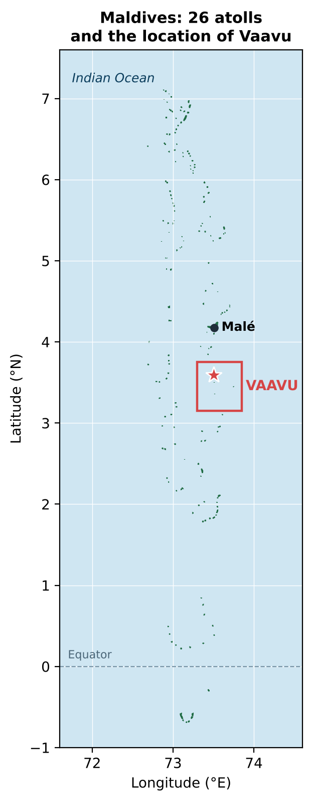 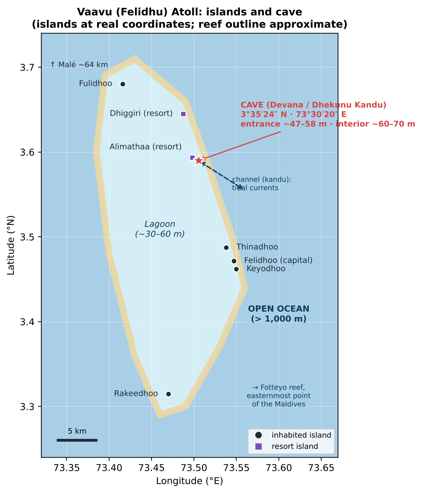

*Left: the 26 natural atolls of the Maldives and the location of Vaavu. Right: Vaavu Atoll with its islands (real coordinates) and the cave. Author's own diagrams.*

### 4.1 The Maldives: a country made of reef

- About **1,190 islands** grouped into **26 natural atolls** in the Indian Ocean, south-west of India, stretching about 870 km from north to south and crossing the equator.
- It is the **lowest-lying country in the world**: average ground level is about 1.5 m above sea level.
- The word **atoll** itself comes from the language of the Maldives, *Dhivehi* (*atholhu*).
- The islands are not volcanoes or mountains: they are **coral sand** piled up on reefs that grew on top of a sunken volcanic ridge (the Chagos–Laccadive Ridge).

### 4.2 How an atoll forms (and why there are caves)

Charles Darwin proposed the explanation accepted today in 1842:

1. A volcano emerges in a tropical sea and coral grows along its shore (**fringing reef**).
2. The volcano slowly sinks, but the coral keeps growing upwards towards the light (**barrier reef**).
3. The volcano disappears under water, leaving only a **ring of coral** around a central **lagoon**: the **atoll**.

During the ice ages sea level dropped by more than 100 m. The reefs were left exposed, rainwater dissolved the limestone and carved out **caves, overhangs and passages**. When the sea rose again, those cavities were flooded in the walls of the channels. The cave where the accident happened is one of them.

### 4.3 Vaavu (Felidhu) Atoll

| Fact | Value |
|---|---|
| Official name | Vaavu (in *Dhivehi*: Felidhu Atholhu) |
| Made up of | **Felidhu** Atoll + the isolated **Vattaru** reef |
| Population | ~1,600 inhabitants: the **least populated** administrative atoll in the country |
| Capital | **Felidhoo** |
| Inhabited islands | Felidhoo, Fulidhoo, Keyodhoo, Rakeedhoo and Thinadhoo |
| Resorts | **Alimatha** (on Alimathaa island) and **Dhiggiri** |
| Distance from Malé | ~64 km: ~1 h by speedboat, ~3 h by *dhoni* (traditional boat) |
| Record | **Fotteyo**, at its eastern tip, is the easternmost point of the Maldives |

Vaavu is famous among divers because its eastern edge faces the **open ocean**: the seabed drops to more than a thousand metres, and currents flow in and out through the channels carrying plankton, which attracts sharks, rays and schools of fish.

*Felidhoo (Vaavu Atoll), November 2023. Photo: Z thomas, CC0, via Wikimedia Commons.*

### 4.4 Kandu, thila, giri: the local vocabulary

The name of the cave already tells you where it is. In *Dhivehi*:

| Word | Meaning | Why it matters |
|---|---|---|
| **Kandu** | Channel cutting through the ring of the atoll | All the tidal water flows through it: **strong currents** |
| **Thila** | Submerged reef pinnacle, its top at about 10–15 m | Gathering place for fish and sharks |
| **Giri** | Reef reaching almost to the surface | |
| **Faru** | Ring-shaped reef | |
| **Falhu** | Lagoon | |
| **Miyaru** | Shark | That is why the neighbouring channel is called *Miyaru Kandu*, "shark channel" |
| **Dhekunu** | South | *Dhekunu Kandu* = "south channel" |

**Devana Kandu** is a channel split in two by a central *thila*, south of Alimathaa. Dive guides describe it as a **drift dive for advanced divers**, with strong tide-dependent currents, walls with **caves, overhangs and soft corals**, and recreational depths of 5 to 30 m that the current can push down to 40 m. It is a **protected marine area**. The deep cave where the accident happened opens lower down, in the wall of the channel.

### 4.5 Why people go there

- **Alimatha by night:** dozens of **tawny nurse sharks** and stingrays gather at the resort jetty. It is one of the best-known night dives in the Maldives.
- **Shark channels:** in Miyaru Kandu and Devana Kandu, groups of **grey reef sharks** hold position against the current, alongside eagle rays, barracuda, giant trevally and Napoleon wrasse.
- **Soft corals:** the channel walls, where the current brings food, are covered in colourful soft corals and sea fans.
- **Science:** the University of Genoa was studying **soft corals** there. According to Russian expert Vladimir Tochilov, who explored the cave in 2014, it has **its own fauna and flora not seen outside**, which made it attractive to biologists.

**When to go:** from December to April the north-east monsoon (*iruvai*) blows: calm seas and the best visibility (often 20–30 m). From May to November the south-west monsoon (*hulhangu*) brings more wind, rain and swell. **The accident happened just as the south-west monsoon was starting**, under a yellow alert for wind and very rough seas, and with spring tides due to the new moon on 16 May.

*Nurse sharks on the Alimatha night dive (Vaavu). The file labels them Ginglymostoma cirratum, the Atlantic species; in the Maldives the species is the tawny nurse shark (Nebrius ferrugineus). Photo: Jun V Lao, CC BY-SA 4.0, via Wikimedia Commons.*

### 4.6 What marine life you will find

Light decides what lives at each depth. Water absorbs red first (about 5 m), then orange, yellow and green. Below about 40 m only blue remains and light-dependent coral disappears. No light at all reaches the inside of the cave.

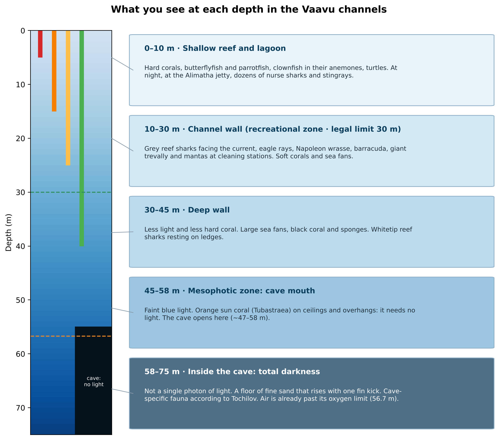

| Species | Scientific name | Depth | Did you know? |
|---|---|---|---|
| Tawny nurse shark | *Nebrius ferrugineus* | 5–70 m | At night at Alimatha; by day it rests in caves and under overhangs. Several were present during the recovery of the bodies |
| Grey reef shark | *Carcharhinus amblyrhynchos* | 10–60 m | The star of the *kandu*: patrols in groups against the current |
| Whitetip reef shark | *Triaenodon obesus* | 8–40 m | Rests by day in caves and on sandy ledges |
| Tiger shark | *Galeocerdo cuvier* | 0–100 m+ | Briefly interrupted the last recovery dive |
| Eagle ray | *Aetobatus ocellatus* | 1–60 m | "Flies" in groups over the channel |
| Reef manta ray | *Mobula alfredi* | 1–40 m | Visits "cleaning stations" |
| Napoleon wrasse | *Cheilinus undulatus* | 5–60 m | Can exceed 1.5 m; listed as Endangered by the IUCN |
| Giant trevally | *Caranx ignobilis* | 10–80 m | A major predator of the channels |
| Barracuda | *Sphyraena* spp. | 5–50 m | Forms spiralling schools |
| Hawksbill turtle | *Eretmochelys imbricata* | 1–40 m | Critically Endangered |
| Sun coral (orange cup coral) | *Tubastraea* spp. | 1–80 m | Does not photosynthesise: it thrives precisely **in the shade of caves and overhangs** |
| Soft corals | *Dendronephthya* and others | 5–60 m | What the expedition was studying |

*Left: tawny nurse shark (Nebrius ferrugineus) in the Maldives. Photo: Julien Bidet, CC BY-SA 4.0. Right: grey reef shark, the typical species of the channels. Photo: Kevin Lino / NOAA, CC BY 2.0. Both via Wikimedia Commons.*

*Left: eagle ray (Aetobatus ocellatus) in the Maldives. Photo: Ahmed Abdul Rahman, CC BY-SA 4.0. Right: Napoleon wrasse in the Maldives. Photo: Julien Bidet / MDC Seamarc, CC BY-SA 4.0. Both via Wikimedia Commons.*

*Left: reef manta ray in the Maldives. Photo: Shiyam ElkCloner, CC BY-SA 3.0. Right: sun coral (Tubastraea), typical of cave ceilings and overhangs. Photo: Franklin Samir Dattein, CC BY 2.0. Both via Wikimedia Commons.*

*Giant trevally (Dwayne Meadows / NOAA, public domain), hawksbill turtle (Thierry Caro, CC BY-SA 3.0) and Dendronephthya soft coral (Alexander Vasenin, CC BY-SA 3.0). Photos from other parts of the Indo-Pacific, of species found in Vaavu. Via Wikimedia Commons.*

### 4.7 The cave

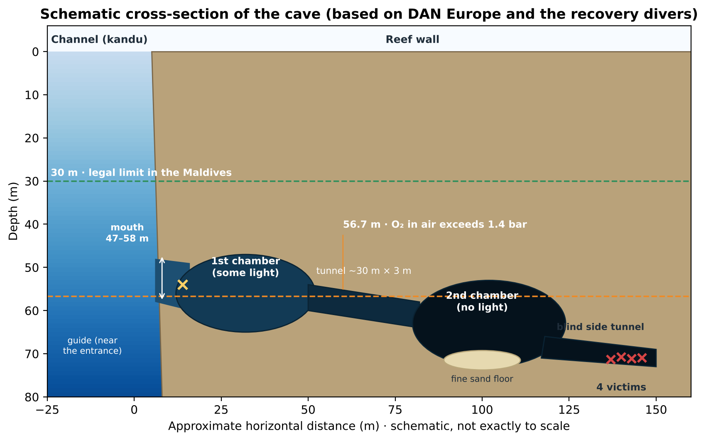

| Feature | Size | Source |
|---|---|---|
| **Entrance** | ~47 m (CNN, *Open*) · 50–58 m (*Maldives Independent*) · 55–60 m (DAN Europe) | Varies with where it is measured |
| **1st chamber** | Large, still with some natural light (cavern) | DAN Europe |
| **Connecting tunnel** | ~30 m long and ~3 m wide | Finnish divers (*Quotidiano Nazionale*) |
| **2nd chamber** | Large, **no natural light**, floor of fine sand and sediment | DAN Europe |
| **Side tunnel** | Branches off the 2nd chamber **next to the entry tunnel**; it is **blind** and **was not on any map** | DAN Europe, *Maldives Independent* |
| **Maximum depth** | ~60–70 m | CNN, *Maldives Independent* |
| **Total length** | ~200 m with several halls | Vladimir Tochilov (CNN) |

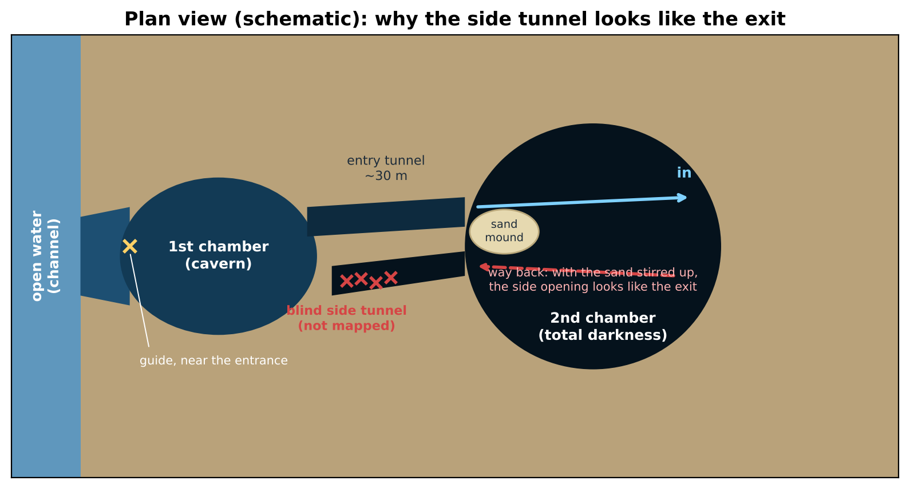

**The trap, as explained by the divers who went through it:** on the way in, you cross the 2nd chamber past a mound of sand. On the way back, with the sand stirred up and torchlight bouncing off the cloud, that mound **hides the mouth of the correct tunnel**, while the mouth of the side tunnel, right next to it, looks like the exit. The four bodies were found together at the far end of that side tunnel. Benedetti, the guide, was found near the entrance with an empty cylinder: he may have found the exit, or gone back in to look for the others.

---

## 5. Timeline

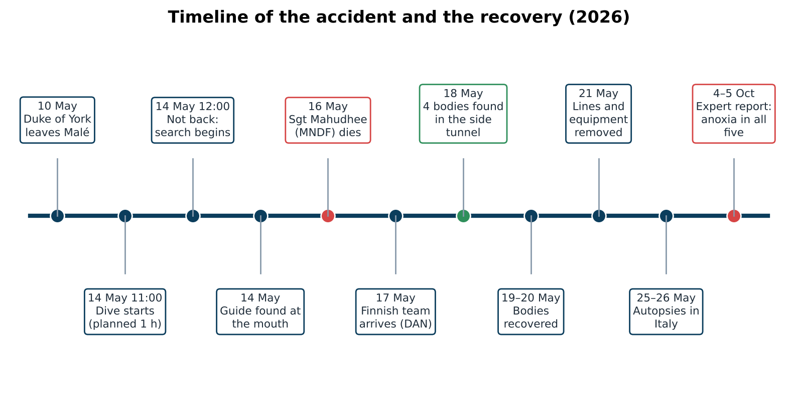

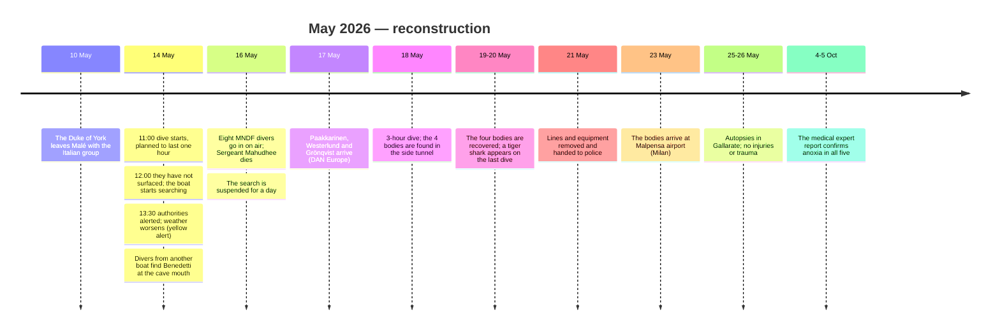

---

## 6. What the images show

*(This study does not reproduce images of the victims.)*

1. **DAN Europe's footage** (released on 22 May): filmed by the Finnish team under their lights, it shows the route from the 1st chamber, still lit with a bluish glow, to the 2nd chamber, completely black, with a pale sandy floor. It makes it clear why the exit is not obvious on the way back.
2. **The victims' GoPro:** it was recovered inside the cave. Together with the **dive computers** (which log depth and time second by second), it is the accident's "black box". In October 2026, Rome prosecutors were still asking the Maldives to hand over that equipment.
3. **What is still unknown:** how long they spent inside, at exactly what depth, and when they got lost. All of that will come from the computers and the camera if the authorities publish their analysis.

> 🔍 **Important nuance:** the images that circulated on social media under titles like "the cave of death" were filmed by the **rescuers**, not the victims.

---

## 7. Why they died: a point-by-point analysis

The numbers in this section are the author's own calculations, made with standard diving formulas and checked with a Python script ([`scripts/calculos_y_figuras_en.py`](scripts/calculos_y_figuras_en.py), results in [`calculations_en.txt`](calculations_en.txt)).

### 7.1 Pressure (Boyle's law)

In the sea, every **10 m** of depth adds **1 bar** of pressure, on top of 1 bar from the atmosphere.

$$P_{\text{absolute}} = 1 + \frac{\text{depth (m)}}{10}$$

| Depth | Absolute pressure | One litre of surface air takes up… |
|---|---|---|
| 0 m | 1 bar | 1 L |
| 30 m (Maldivian limit) | 4 bar | 0.25 L |
| 47 m (entrance, according to CNN) | 5.7 bar | 0.18 L |
| **60 m** (interior) | **7 bar** | **0.14 L** |
| 69 m (where Mahudhee was found) | 7.9 bar | 0.13 L |

**Consequence:** at 60 m every breath takes **seven times** more air from the cylinder than at the surface.

### 7.2 Nitrogen narcosis ("rapture of the deep")

Air is **79% nitrogen**. Under **Dalton's law**, each gas in a mixture contributes its share of the total pressure (its **partial pressure**). Under **Henry's law**, the higher that partial pressure, the more gas dissolves in the blood and the brain.

- Partial pressure of nitrogen at 60 m: 0.79 × 7 ≈ **5.5 bar**, seven times its surface value.
- Informal **"Martini's law"**: every 10 m below 20 m equals one martini. At 60 m: **about 4 martinis**.
- Effects: euphoria, overconfidence, tunnel vision, slow thinking, fixation on one idea.

> 🧠 **Why it matters here:** in a cave you have to **remember the route**, **track your gas** and **decide when to turn back**. Narcosis attacks exactly those three things, and gives no warning. John Volanthen, one of the divers in the 2018 Thai cave rescue, put it this way to CNN: narcosis "could potentially create panic, but it could also make them less likely to be able to find their way out".

### 7.3 Oxygen becomes toxic

Oxygen is **toxic** to the central nervous system when its partial pressure (**ppO₂**) is too high. It can cause **convulsions without warning**; underwater, a convulsion usually makes the diver lose the regulator.

- Working limit: **1.4 bar**. Contingency maximum: **1.6 bar**.
- **Maximum operating depth (MOD)** of air: 10 × (1.4 / 0.21 − 1) ≈ **56.7 m** · at 1.6 bar ≈ **66 m**.
- ppO₂ of air at 60 m: 0.21 × 7 ≈ **1.47 bar** (above the working limit). At 69 m: **1.66 bar** (above the maximum).

> 💡 **Telling detail:** the cave sits **right in the band where air stops being safe**. The entrance is above 56.7 m; the interior is below it.
>
> **What if they were on nitrox?** Some Italian media reported that the cylinders held **nitrox 28** (28% oxygen). With that mix, the ppO₂ at 60 m would be **1.96 bar**, far above the maximum. This is unconfirmed: most sources say **ordinary air**.

### 7.4 Gas density and CO₂

At 7 bar, air is **seven times denser**: about **8.6 g/L** (versus 1.2 g/L at the surface).

- Anthony and Mitchell (2016) recommend not exceeding **5.2 g/L** and never exceeding **6.2 g/L**. On air, those limits are reached at about **32 m** and **41 m**.
- Such a dense gas flows poorly through the airways. It takes more effort to move, and **CO₂ builds up** (**hypercapnia**).
- Excess CO₂ causes **breathlessness and anxiety**, **worsens narcosis** and **increases the risk of oxygen toxicity**.

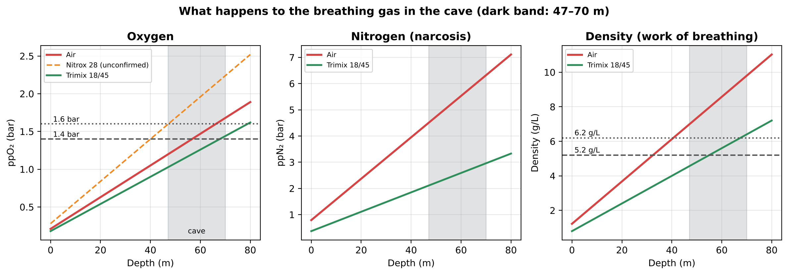
*Partial pressure of oxygen, partial pressure of nitrogen and air density by depth. The dark band is the cave zone. Author's calculation.*

> 🔄 **The vicious circle:** dense gas → CO₂ builds up → breathlessness → faster breathing → more CO₂ and more air used → panic. When someone is lost in the dark, this circle spirals out of control.

### 7.5 How long a cylinder lasts at 60 m

| Situation | Surface consumption (SAC) | Consumption at 60 m | Minutes from a 12 L cylinder at 200 bar (2,400 L) |
|---|---|---|---|
| Very relaxed | 15 L/min | 105 L/min | **≈ 23 min** |
| Normal | 20 L/min | 140 L/min | **≈ 17 min** |
| Effort | 30 L/min | 210 L/min | **≈ 11 min** |
| Stress | 45 L/min | 315 L/min | **≈ 8 min** |
| Panic | 60 L/min | 420 L/min | **≈ 6 min** |

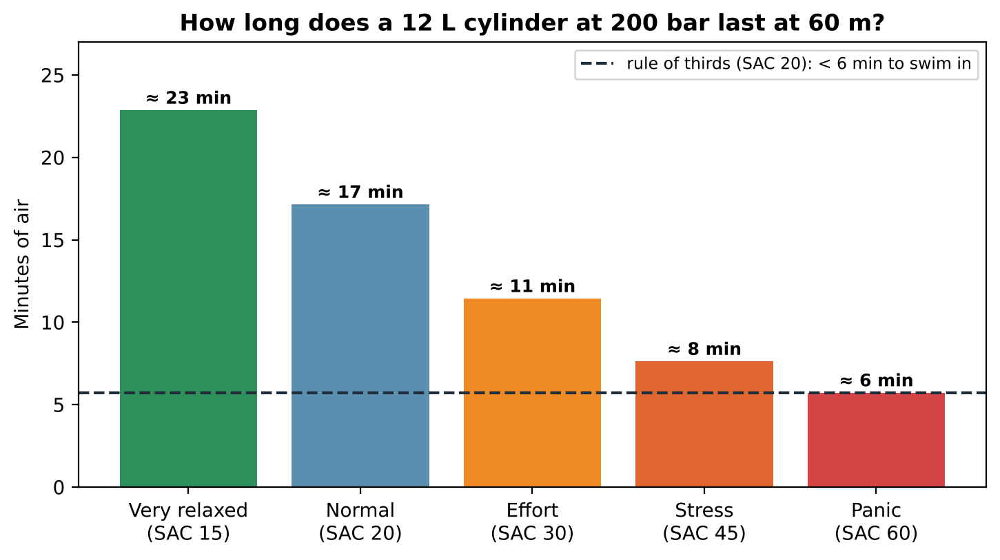

*Author's estimate using the 12 L cylinder cited in the reports. It matches what the experts said: DAN Europe spoke of **10–12 minutes** of gas "with that type of cylinder", and Patrik Grönqvist of about **ten minutes**.*

**And that counts the cylinder's entire contents**, without setting aside the gas needed to descend, to ascend or for decompression stops.

### 7.6 Decompression: even if they had got out, there was no gas to ascend

At 60 m the body absorbs nitrogen very quickly. To avoid **decompression sickness** you have to ascend slowly and make **decompression stops**. With a standard model (Bühlmann ZH-L16C, gradient factors 30/85, normal consumption), **for educational purposes only**:

| Time at 60 m | Ascent time | Total gas required | Gas available |
|---|---|---|---|
| 20 min | ≈ 68 min | ≈ 5,200 L | 2,400 L |
| 30 min | ≈ 129 min | ≈ 8,800 L | 2,400 L |
| 45 min | ≈ 250 min (over 4 h) | ≈ 15,200 L | 2,400 L |

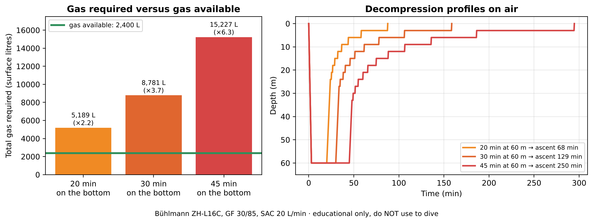

> ⚖️ **Conclusion:** with a single 12 L cylinder **no plan exists** that makes that dive safe. The gas required is **2 to 6 times** what they carried. The decisive error was not made inside the cave but **before getting into the water**. ⚠️ Do not use these figures to plan a real dive.

### 7.7 Getting lost in a cave: darkness, sediment and an unmapped tunnel

This is the point that, according to DAN Europe, explains what happened.

1. **No natural light, no reference.** Edd Sorenson, a cave rescue specialist, told *The Guardian*: "Caves are not dark. They're devoid of light. Your house at night is dark… When your light goes out [in a cave], there's nothing." The eye cannot adjust because there is not a single photon.
2. **Sediment ("silt-out").** The floor of the 2nd chamber is fine sand. An ordinary open-water kick (the up-and-down *flutter kick*) close to the bottom stirs it up and visibility goes from perfect to **zero in seconds**. Cave divers use the **frog kick**, which pushes water backwards rather than downwards.
3. **No guideline.** Reports agree that **no guideline was used**. In cave diving it is rule number one: a **continuous line from open water** to the farthest point. If visibility is lost, you follow the line **by touch** to the exit.
4. **The mound and the twin tunnel.** The mouth of the correct tunnel was hidden by the sand mound, and the mouth of the side tunnel, right next to it, looked like the exit (see [§4.7](#47-the-cave)).
5. **A tunnel that was on no map.** Sami Paakkarinen found the victims by following **marks in the sand** into an uncharted tunnel. That is why he later called for the cave to be properly surveyed.

### 7.8 Did a current drag them in?

Italian hyperbaric physician Pasquale Longobardi (SIMSI) suggested that an unexpected current, strengthened by the onset of the monsoon and the spring tides, may have pushed them inwards (the **Venturi effect**: water speeds up as it passes through a narrowing). **This is unconfirmed.** DAN Europe does not mention it, and divers who know the cave say it does not normally have significant currents. It remains an open hypothesis with low confidence (0.3).

### 7.9 The human factor

- **Overconfidence.** Laura Marroni of DAN Europe summed it up in one word: *overconfidence*. Being very good in open water does not make you good in caves.
- **Authority within the group.** When a group includes a professor with 5,000 dives and an instructor who knows the area, the others find it hard to say "no". In aviation this is called the **authority gradient**.
- **A group is only as safe as its least prepared member.** Five people in a cave means five clouds of sand and five different consumption rates.
- **Normalisation of risk.** If a "risky" dive has gone well before, the risk stops looking like one.
- **Target fixation.** Seeing fauna that exists nowhere outside the cave was a genuine scientific motive, and that pushes people to keep going.

---

## 8. The chain of errors

Safety science uses the **Swiss cheese model**: an accident rarely has a single cause. It happens when the holes in several layers of protection line up.

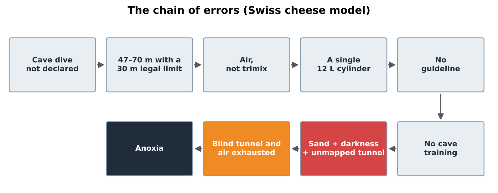

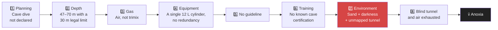

| Link | Verified? | Confidence |
|---|---|---|
| The cave was not in the permit and the government did not know the exact location | Yes (government spokesman, *Open*, *Maldives Independent*) | 0.9 |
| Depth of 47–70 m, beyond the 30 m limit | Yes (all sources) | 0.95 |
| Ordinary compressed air and 12 L cylinders | Very likely (DAN, IVG, Divernet, *Maldives Independent*) | 0.8 |
| No guideline | Likely (Wikipedia, *Divevolk*, Finnish divers) | 0.75 |
| No full cave training | Likely; the only public figure is a basic cavern level for one of them | 0.6 |
| Disorientation and wrong side tunnel | Yes: DAN's preliminary hypothesis and the position of the bodies | 0.85 |
| Death from running out of air (anoxia) | Yes: medical expert report | 0.9 |
| A current dragged them in | Unconfirmed | 0.3 |
| Oxygen toxicity as a direct cause | Possible only if they were on nitrox; unconfirmed | 0.3 |

---

## 9. How it could have been prevented

Each row is a slice of the Swiss cheese. **Had just one of them worked, they would most probably be alive today.**

| What happened | What a well-planned cave dive does | What it would have prevented |
|---|---|---|
| Cave dive not declared | Written plan, a specific deep-exploration permit and notifying the authorities of the exact site | The authorities would have refused it or required technical equipment |
| 60 m on air | **Trimix** (oxygen + helium + nitrogen), e.g. **18/45** (18% O₂, 45% He): at 60 m it gives ppO₂ ≈ 1.26 bar and narcosis equivalent to about 23 m | A clear head to navigate and decide |
| A single 12 L cylinder | **Two independent cylinders** (twinset or *sidemount*) + **stage cylinders** with decompression gas, or a **rebreather** with *bailout* cylinders | Enough gas to get back and to decompress |
| No gas plan | **Rule of thirds:** 1/3 to go in, 1/3 to come out and 1/3 in reserve for a buddy. At 60 m with 12 L and normal consumption, that leaves **less than 6 minutes** to swim in | The rule would have said "no" before anyone got wet |
| No guideline | **Continuous line** from open water on a reel; direction **arrows** pointing to the exit and **personal markers** | They would have got out by touch along the line |
| Ordinary kicking | **Frog kick** and perfect buoyancy control, well off the bottom | Without the sand cloud, the exit would have been visible |
| One torch | **Rule of three lights:** one primary and two backups per diver | Never in the dark |
| Group of five with mixed levels | Teams of **2 or 3** divers with the **same training**, agreed signals and a fixed order | More control and less sediment |
| Open-water training | The training ladder: **cavern → intro to cave → full cave**, plus trimix and decompression | The techniques they lacked |
| Incompletely mapped cave | Prior survey, or a reconnaissance dive with a guide who knows it | Knowing there was a twin tunnel |
| Bad weather and spring tides | Call the dive off. Cristina Zenato, cave instructor: "I've sat on that water's edge when I said 'not today'" | More margin against a current or a problem |
| Boat without a dive-school licence | A licensed operator with an emergency protocol, oxygen and evacuation to a hyperbaric chamber | A faster, safer rescue |

*Cave diver running a guideline from open water into the interior. This is the basic technique that, according to the reports, was not used. Photo: Ryan Cantey, CC BY-SA 3.0, via Wikimedia Commons.*

*Left: diver in a "sidemount" configuration (cylinders at the sides), widely used in caves. Photo: Pete Nawrocky, CC BY-SA 3.0. Right: closed-circuit rebreather, the type of equipment the Finnish team used. Photo: EMDX, CC BY-SA 4.0. Both via Wikimedia Commons.*

---

## 10. The recovery and the sixth victim

### 10.1 The MNDF attempt and the death of Sergeant Mahudhee

On Saturday 16 May, a team of **eight divers** from the Maldivian Coast Guard (MNDF) went into the cave **on air with standard equipment**: the same kind of equipment that had failed two days earlier. According to the *Maldives Independent*'s reconstruction:

- The pocket holding his **guideline reel** came loose; he became separated from the group and followed another diver into the 2nd chamber.
- He was found at **69 m** with an empty cylinder and the regulator out of his mouth. He had been missing for **at least 75 minutes**.
- At 69 m on air: ppO₂ = **1.66 bar** (above the maximum) and density ≈ **9.7 g/L**.
- The death certificate cites **cerebral arterial gas embolism** from a rapid ascent. His family disputes this: hospital records show he arrived **with no pulse**, and a diving physician who reviewed them believes he **had already died in the cave**. No autopsy was performed.
- MNDF commanders themselves acknowledged that their divers are certified only to **50 m**. There was no hyperbaric chamber on site.

> 🧭 **The hardest rule of rescue:** **do not create more victims.** A rescuer who goes in under the same conditions that caused the accident runs the same risk. The international team was arriving the next day. Recovering bodies never justifies risking the living.

### 10.2 DAN Europe's Finnish team

| Aspect | Fact |
|---|---|
| Divers | **Sami Paakkarinen, Jenni Westerlund and Patrik Grönqvist** |
| Experience | The same divers who in 2014 recovered two divers who died in the **Plura** cave (Norway), at more than 100 m |
| Equipment | Closed-circuit **rebreathers**, **diver propulsion vehicles** (*scooters*) and duplicated life-support systems |
| Support | Maldivian diving teams at mid and shallow depths; specialist equipment from the UK and Australia |
| Dives | About **3 hours** each; on the last one, about 50 minutes of work inside the cave |
| Finding | On 18 May, with about **5 minutes** to spare before they had to turn back |
| Method | They brought the bodies up to **~30 m** on stretchers, where Maldivian divers took over |
| Wildlife | Nurse sharks during the first recoveries and a **tiger shark** that briefly interrupted the last one |
| Recognition | Italian President Sergio Mattarella awarded them the **Order of Merit** |

Jenni Westerlund described the method: "We used scooters. One of us led and opened the way; the other assisted, checked and handled the load. There are narrow passages where you can barely move, and then suddenly a wider area opens up."

---

## 11. Permits, responsibilities and investigations

### 11.1 What the rules allowed

| Rule or permit | What it said |
|---|---|
| Maldivian recreational diving regulation (2003) | **30 m** limit |
| University of Genoa research permit | 3–17 May, in six atolls including Vaavu, to study soft corals **down to 50 m**. It **did not mention caves** or specific sites, and **did not include two** of those who died |
| *Duke of York* licence | **Recreational only (30 m)**. According to the government, it lacked the **dive-school licence** required to run expeditions |
| Deep-exploration permit | The only legal way into that cave. **They did not have one** |
| Technical diving | The Maldives had **no regulation at all** distinguishing technical from recreational diving below 30 m |

### 11.2 Who says what

- **Maldivian government** (spokesman Mohamed Hussain Shareef): they were not told the group would enter a cave; had they known, they would have given "much clearer guidelines". It suspended the boat's licence.
- **Boat operator** (Abdul Muhsin Moosa): the boat had a recreational permit to 30 m.
- **Albatros Top Boat**, the Italian tour operator that chartered the trip (lawyer Orietta Stella): it never authorised a cave penetration at 50 m, and the dives were organised by the researchers.
- **University of Genoa:** the dive was private; diving on scientific missions had been banned since March 2024.
- **Lawyers for the Gualtieri family:** "No one knows who organised the dive, for what purpose or with what equipment."

### 11.3 The investigations

- **Italy:** on 19 May, Rome prosecutors opened an investigation for **negligent homicide**, with no one publicly named. They sent a letter rogatory to the Maldives to obtain the dive computers, cameras and cylinders.
- **Maldives:** it is investigating whether those responsible took proper precautions. By August there was no public report.
- **New law:** on 23 May the government announced a **technical and wreck diving** (*Tech-Wreck*) law: permits only for researchers and highly certified technical divers, with specialist equipment and "very stringent guidelines". The MNDF plans to train its divers to 100 m before the end of 2026.

---

## 12. Hypotheses: ruled out and still open

| Hypothesis | Status | Reasoning |
|---|---|---|
| Shark attack | ❌ Ruled out | No wildlife injuries in the autopsies. The local nurse sharks are docile |
| Air contaminated with carbon monoxide | ❌ Ruled out according to *Geopop* | No CO or other substances found. *Divernet* said on 9 October that toxicology was still pending: this needs confirming |
| Narcosis as the **sole** cause | ❌ Not enough | It wears off on ascent; on its own it does not explain why five people could not find the exit. It is an **aggravating factor** |
| Oxygen toxicity | ⚠️ "Ruled out" according to *Geopop*, but… | An oxygen convulsion **leaves no trace** at autopsy. It is only plausible if they were on nitrox. Low confidence (0.3) |
| **Disorientation and wrong tunnel** | ✅ The most likely | Position of the bodies, DAN's report and the Finnish divers' description (0.85) |
| **Running out of air** | ✅ Confirmed | Anoxia in all five and Benedetti's empty cylinder (0.9) |
| A current dragged them in | ❓ Open | Monsoon and spring tides for; divers' testimony against (0.3) |
| Panic sped up gas consumption | ❓ Very likely as an aggravating factor | The physics of consumption (see [§7.5](#75-how-long-a-cylinder-lasts-at-60-m)) |

---

## 13. Myths versus reality

| Myth | Reality | Confidence |
|---|---|---|
| "They were beginners" | They were highly experienced in open water, but there is no record of full cave training | 0.85 |
| "They ran out of oxygen" | They ran out of **air**. Pure oxygen would be toxic at 60 m | 0.9 |
| "A shark attacked them" | No wildlife injuries at all | 0.95 |
| "It was a university dive" | The university denies it; the permit did not cover caves | 0.7 |
| "The cave has a killer current" | Unconfirmed hypothesis; it does not normally have strong currents | 0.7 |
| "The rescuer died of decompression sickness" | That is what the government said on the first day; the hospital and the family suggest he died inside the cave | 0.6 |
| "The images show the victims" | They are images filmed by the rescuers | 0.9 |

---

## 14. Cross-checking sources: figures that do not match

| Fact | Version A | Version B | Most likely and why |
|---|---|---|---|
| **Name of the cave** | Dhekunu Kandu (DAN, Wikipedia) | Devana Kandu (Maldivian press), Thinwana Kandu, "Shark Cave" | **The same cave**; the names come from the channel and its *Dhivehi* variants |
| **Depth of the entrance** | ~47 m (CNN, *Open*) | 55–60 m (DAN) | **47–60 m**: depends on whether the top or bottom of the mouth is measured |
| **Where the 4 bodies were found** | "Third chamber" (CNN, *The Standard*, Maldives) | Side tunnel off the 2nd chamber (DAN) | **The side tunnel**: the press called it the "third chamber" |
| **Where Benedetti was** | At the cave mouth (CNN, government) | At ~60 m in the 1st or 2nd chamber (Italian press) | **1st chamber / near the entrance** |
| **When Benedetti was recovered** | The same day, 14 May (Divernet, CNN) | 15 May (*Maldives Independent*) | He was **located** on the 14th; the **recovery** may have been completed on the 15th |
| **Gas** | Air (DAN, *Geopop*, *Maldives Independent*) | Nitrox 28 (some Italian media) | **Air**, until the cylinder analysis is published |
| **Ages of Montefalcone / Sommacal** | 51 / 23 (*Maldives Independent*) | 52 / 20 (*Il Sole 24 Ore*) | Unconfirmed |
| **Cause of Mahudhee's death** | Decompression sickness (government, first day) | Death in the cave; embolism or post-mortem changes (hospital, family) | **Undetermined** |
| **Toxicology** | Negative (*Geopop*, October) | Pending (*Divernet*, 9 October) | Probably completed in early October |

---

## 15. Technical glossary

| Term | Meaning |
|---|---|
| **Anoxia** | Total lack of oxygen in the tissues. Here, because the air ran out |
| **Arterial gas embolism** | Gas bubbles in the arteries, usually from ascending fast with air in the lungs |
| **Atoll** | Ring of coral reef around a central lagoon. The word comes from *Dhivehi* |
| **Authority gradient** | Difficulty in challenging someone with more rank or experience |
| **Bailout** | Emergency cylinder carried by a rebreather diver |
| **bar** | Unit of pressure. 1 bar ≈ atmospheric pressure at sea level |
| **Boyle's, Dalton's and Henry's laws** | Gas laws: volume and pressure; partial pressures; gas dissolved in the blood |
| **Cave diving** | Diving in flooded caves |
| **Cavern** | Part of a cave from which daylight can still be seen |
| **CO₂ / hypercapnia** | Too much carbon dioxide in the blood: breathlessness, anxiety, confusion |
| **DAN** (*Divers Alert Network*) | International diving safety and medicine organisation |
| **Decompression** (stops) | Stops during the ascent to off-gas nitrogen without forming bubbles |
| **Decompression sickness** (DCS) | Injury from nitrogen bubbles after ascending too fast |
| **Frog kick** | Horizontal kick that pushes water backwards; it does not stir up sediment |
| **Gas density** | Mass per litre of breathing gas; the deeper you go, the harder it is to breathe |
| **Guideline** | Continuous line from open water marking the way back |
| **Kandu / thila / giri / faru** | Channel / submerged pinnacle / reef reaching almost to the surface / ring-shaped reef |
| **Light zone** | Part of the cave from which the exit can still be seen |
| **Liveaboard** | Cruise boat on which divers live for days to dive |
| **MNDF** | Maldives National Defence Force, which includes the Coast Guard |
| **MOD** | Maximum operating depth of a gas mix, based on its ppO₂ |
| **Monsoon** | Seasonal wind: *iruvai* (north-east, Dec–Apr) and *hulhangu* (south-west, May–Nov) |
| **Nitrogen narcosis** | Anaesthetic effect of nitrogen under pressure; similar to drunkenness |
| **Nitrox** | Air enriched with more than 21% oxygen; unsuitable for 60 m |
| **Oxygen toxicity (CNS)** | Effect of oxygen on the brain above ~1.4–1.6 bar: convulsions |
| **Partial pressure** (ppO₂, ppN₂) | The share of the total pressure due to each gas |
| **Rebreather** (CCR) | Equipment that recycles exhaled gas and replenishes the oxygen; uses very little gas |
| **Recreational diving** | No mandatory decompression stops; in the Maldives, down to 30 m |
| **Rule of thirds** | One third of the gas to go in, one to come out and one in reserve |
| **Rule of three lights** | One primary torch and two backups |
| **SAC** | Gas consumption per minute in surface litres |
| **Sidemount** | Cylinders attached along the sides of the body; useful in tight passages |
| **Silt-out** | Total loss of visibility from stirred-up sediment |
| **Stage cylinder** | Extra cylinder carried at the side, with gas for a specific phase of the dive |
| **Technical diving** | Beyond recreational limits: greater depth, special gases, decompression or an overhead environment |
| **Trimix** | Mix of oxygen, helium and nitrogen for deep dives |
| **Twinset** | Two cylinders joined on the back with two independent regulators |
| **Venturi effect** | Water speeding up as it passes through a narrowing |

---

## 16. Lessons for any diver

1. **A cave is a different sport.** Open-water experience does not count inside.
2. **No guideline, no entry.** Ever.
3. **Work out your gas before you get wet.** If the rule of thirds gives you five minutes, the answer is no.
4. **Air has limits:** because of gas density at around 32–41 m, and because of oxygen at around 57–66 m.
5. **Respect local law.** In the Maldives the limit is 30 m for a reason.
6. **Anyone can say "not today"**, even the least experienced member of the group.
7. **In a rescue, the first life is the rescuer's.**
8. **Seeing something unique is never worth a life.**

---

## 17. Method, limitations and confidence level

**How the study was done:**

1. The case was broken down into parts: facts, place, cave, physics, physiology, navigation, human factor, rescue, responsibilities and myths.
2. Every fact was checked against at least two independent sources wherever possible, in English, Italian and Spanish. Discrepancies are listed in [§14](#14-cross-checking-sources-figures-that-do-not-match).
3. The calculations (pressure, ppO₂, MOD, density, gas supply, decompression) use standard formulas and can be reproduced with the script in the repository.
4. All the text is original writing: no paragraphs are copied from any source. Direct quotes appear in quotation marks with their author.
5. **Originality check (31/10/2026):** exact phrases from the study and similar analyses were searched for online, with no matches. There are technical analyses in English (*Divevolk*, on the nitrox hypothesis; articles such as "Anatomy of deep cave diving disasters: the Vaavu Atoll cascade" republished on several websites), reports in Spanish such as *¡Hola!*'s piece on the "invisible trap" of the sand, and press articles, but no study was found that brings together the geography of Vaavu, the physics with decompression calculations, the recovery, the responsibilities, the cross-checking of sources and the glossary.

**Limitations:**

- The dive-computer data and the GoPro footage have not been published. The exact sequence of events **is not known**.
- There is no final official report from either the Maldives or Italy.
- The training of each victim is not known with certainty.
- The decompression calculations are **educational** and must not be used for diving.

**Overall confidence:**

| Block | Confidence |
|---|---|
| Basic facts (who, when, where, depth) | 0.9 |
| Physics and physiology (calculations) | 0.95 |
| Geography and marine life of the area | 0.85 |
| Medical cause (anoxia) | 0.9 |
| Exact sequence inside the cave | 0.6 |
| Responsibilities | 0.4 (investigation ongoing) |

---

## 18. Sources

**The accident and the investigation**

- Wikipedia. *2026 Dhekunu Kandu cave diving incident*. https://en.wikipedia.org/wiki/2026_Dhekunu_Kandu_cave_diving_incident
- DAN Europe (22/05/2026). *Dhekunu Kandu: official statement and preliminary reconstruction*. https://www.daneurope.org/en/-/dan-supporta-le-operazioni-internazionali-di-search-recovery-alle-maldive
- Harvey, L. and Chernova, A. (20/05/2026). *Five cave divers slipped beneath the waves in the Maldives. Why didn't they resurface?* **CNN**. https://www.cnn.com/2026/05/20/world/maldives-cave-dive-narrative-dst-intl-hnk
- Yang, M. (23/05/2026). *'If something goes wrong, you can't simply surface'*. **The Guardian**. https://www.theguardian.com/world/2026/may/23/maldives-diving-tragedy-cave-experts-warn-danger-safety
- **Maldives Independent**. *The Devana Kandu tragedy: criminal probe, regulatory gaps, and the questions left unanswered*. https://maldivesindependent.com/explainer/the-devana-kandu-tragedy-criminal-probe-regulatory-gaps-and-the-questions-left-unanswered-e441
- **Maldives Independent**. *Five weeks after the Devana Kandu deaths*. https://maldivesindependent.com/society/five-weeks-after-the-devana-kandu-deaths-what-the-recovery-divers-saw-and-what-investigators-want-b816
- **Maldives Independent**. *The death of Sgt Mahudhee: what the records show*. https://maldivesindependent.com/explainer/the-death-of-sgt-mahudhee-what-the-records-show-15d6
- **Divernet** (09/10/2026). *Italian divers who died in Maldives cave ran out of gas*. https://divernet.com/scuba-news/health-safety/death/italian-divers-who-died-in-maldives-cave-ran-out-of-gas/
- **DeeperBlue**. *DAN Europe: Divers in Maldives cave incident lost their way*. https://deeperblue.com/dan-europe-provides-details-over-tragic-maldives-cave-incident
- **Quotidiano Nazionale** (22/05/2026). *Maldive, i sub finlandesi ipotizzano un errore umano* (in Italian). https://www.quotidiano.net/cronaca/maldive-errore-umano-hanno-sbagliato-strada-uscendo-dalla-grotta-awgd117f
- **IVG** (05/2026). *Tragedia alle Maldive, le prime immagini della grotta e la relazione del team di recupero* (in Italian). https://www.ivg.it/2026/05/tragedia-alle-maldive-le-prime-immagini-della-grotta-e-la-relazione-del-team-di-recupero-presto-le-autopsie/
- **Il Giorno**. *Maldive, i 4 fattori della trappola* (in Italian). https://www.ilgiorno.it/cronaca/maldive-4-fattori-della-trappola-jzlc247j
- **Open** (18/05/2026). *Maldive, sub morti: le autorizzazioni* (in Italian). https://www.open.online/2026/05/18/maldive-sub-italia-morti-autorizzazioni-immersione/
- **Il Sole 24 Ore** (English edition). *Five Italians dead in the Maldives during a dive*. https://en.ilsole24ore.com/art/five-italians-dead-maldives-a-dive-AIS0Dr4C
- **Geopop**. *Sub italiani morti alle Maldive: la causa è anossia* (in Italian). https://www.geopop.it/sub-italiani-morti-alle-maldive-la-causa-e-anossia-mancanza-di-ossigeno-le-ipotesi-ancora-aperte/
- **Libero** / Adnkronos. *Maldive, l'ipotesi dell'iperossia* (in Italian). https://www.liberoquotidiano.it/news/esteri/47731538/maldive-iperossia-cosa-non-funzionato-bombole/
- **Divevolk**. *The Maldives Cave Diving Tragedy of May 2026: A Technical Safety Analysis*. https://www.divevolkdiving.com/blogs/diving-knowledge/maldives-cave-diving-tragedy-may-2026-safety-analysis
- **Adhadhu** (24/05/2026). *Maldives to regulate technical diving following fatal cave accident*. https://adhadhu.com/82159
- **Il Post** (23/05/2026). *I sub finlandesi che hanno recuperato i corpi* (in Italian). https://www.ilpost.it/2026/05/23/sub-finlandesi-corpi-italiani-maldive/
- Spanish-language press: Euronews, *La Vanguardia* (Colombia), RPP, BBC Mundo via *Acento*.

**The area**

- Wikipedia. *Vaavu Atoll*. https://en.wikipedia.org/wiki/Vaavu_Atoll
- Resort Life Travel. *Devana Kandu (Vaavu)*. https://resortlife.travel/dive-sites/devana-kandu-vaavu
- Dive.site. *Devana Kandu*. https://dive.site/explore/site/devana-kandu-Q09G
- Dive Planner Pro. *Alimathaa Kandu*. https://diveplannerpro.com/spots/mv/felidhoo-atoll/alimathaa-kandu-felidhoo-atoll-mv
- Natural Earth (public domain): island outlines on the map of the Maldives.

**Diving physics and physiology**

- DDRC Healthcare. *Gas Density and SCUBA* (summarising Anthony and Mitchell, 2016). https://www.ddrc.org/gas-density-and-scuba/
- Wikipedia. *Nitrogen narcosis*. https://en.wikipedia.org/wiki/Nitrogen_narcosis
- TDI. *Avoid CNS Oxygen Toxicity While Diving Nitrox*. https://www.tdisdi.com/tdi-diver-news/avoid-cns-oxygen-toxicity-while-diving-nitrox/
- Wikipedia. *Cave diving*. https://en.wikipedia.org/wiki/Cave_diving
- Bühlmann, A. A. *Tauchmedizin* (ZH-L16C model), the basis of the decompression calculations.

---

## 19. Image credits

All photographs come from **Wikimedia Commons** and carry free licences that allow reuse with attribution. Maps, cross-sections, charts and diagrams are the author's own work.

| Image | Author | Licence | Original page |
|---|---|---|---|
| Felidhoo (cover) | Ahmed Saffu | CC0 | [Commons](https://commons.wikimedia.org/wiki/File:Felidhoo,_Maldives_(Unsplash).jpg) |
| Felidhoo 2023 | Z thomas | CC0 | [Commons](https://commons.wikimedia.org/wiki/File:Felidhoo_2023-11-07_2.jpg) |
| Nurse sharks at Alimatha | Jun V Lao | CC BY-SA 4.0 | [Commons](https://commons.wikimedia.org/wiki/File:Nurse_Sharks_(Ginglymostoma_cirratum).png) |
| Tawny nurse shark | Julien Bidet | CC BY-SA 4.0 | [Commons](https://commons.wikimedia.org/wiki/File:Ginglymostoma_cirratum_Maldives.JPG) |
| Grey reef shark | Kevin Lino / NOAA Photo Library | CC BY 2.0 | [Commons](https://commons.wikimedia.org/wiki/File:Corl0207_(28225976491).jpg) |
| Eagle ray | Ahmed Abdul Rahman | CC BY-SA 4.0 | [Commons](https://commons.wikimedia.org/wiki/File:Aetobatus_ocellatus_Maldives.jpg) |
| Napoleon wrasse | Julien Bidet / MDC Seamarc | CC BY-SA 4.0 | [Commons](https://commons.wikimedia.org/wiki/File:Cheilinus_undulatus_Maldives.JPG) |
| Reef manta ray | Shiyam ElkCloner | CC BY-SA 3.0 | [Commons](https://commons.wikimedia.org/wiki/File:Dharavandhoo_Thila_-_Manata_Black_Pearl.JPG) |
| Sun coral | Franklin Samir Dattein | CC BY 2.0 | [Commons](https://commons.wikimedia.org/wiki/File:Suncoral1.jpg) |
| Giant trevally | Dwayne Meadows / NOAA | Public domain | [Commons](https://commons.wikimedia.org/wiki/File:Caranx_ignobilis.jpg) |
| Hawksbill turtle | Thierry Caro | CC BY-SA 3.0 | [Commons](https://commons.wikimedia.org/wiki/File:Eretmochelys-imbricata-K%C3%A9lonia-2.JPG) |
| Soft coral | Alexander Vasenin | CC BY-SA 3.0 | [Commons](https://commons.wikimedia.org/wiki/File:Dendronephthya_soft_coral_at_Gilli_Lawa_Laut.JPG) |
| Diver running a guideline | Ryan Cantey | CC BY-SA 3.0 | [Commons](https://commons.wikimedia.org/wiki/File:Cave_diver_running_a_reel.jpg) |
| Sidemount | Pete Nawrocky | CC BY-SA 3.0 | [Commons](https://commons.wikimedia.org/wiki/File:Sidemount_032_Photo_by_Pete_Nawrocky.jpg) |
| Rebreather | EMDX | CC BY-SA 4.0 | [Commons](https://commons.wikimedia.org/wiki/File:Plongee-RecycleurInspiration_20040221-153656.jpg) |
| Maps, cross-section, plan, charts and diagrams (`figs_en/`) | Óscar Ramírez Martín | CC BY-SA 4.0 | Author's own work |

> **Licence of this document:** original text and diagrams under **CC BY-SA 4.0** (required by the CC BY-SA photos it includes). Each photograph keeps its author's licence.

---

*In memory of Monica, Giorgia, Muriel, Federico, Gianluca and Mohamed.*
