# 🌊 La tragedia de la cueva de Vaavu (Maldivas, 2026)

### Física, geografía y cadena de errores del peor accidente de buceo de la historia de Maldivas

> **Estudio divulgativo** · Autor: Óscar Ramírez Martín · Octubre 2026
> Elaborado a partir de fuentes públicas contrastadas y de cálculos propios.

> 📄 **Versión PDF:** [Estudio_Cueva_Vaavu_Maldivas.pdf](Estudio_Cueva_Vaavu_Maldivas.pdf)

> ⚠️ **Nota de respeto.** Este estudio trata la muerte real de seis personas: cinco buceadores italianos y un buzo militar maldivo que murió intentando recuperarlos. No incluye fotografías de las víctimas ni imágenes de sus cuerpos. El objetivo es entender **por qué** ocurrió y **cómo se podría haber evitado**, para que no vuelva a ocurrir.

*Felidhoo, la capital del atolón de Vaavu, con el arrecife y la laguna turquesa a su alrededor. La cueva del accidente está unos 14 km al norte. Foto: Ahmed Saffu, CC0, vía Wikimedia Commons.*

---

## 📑 Índice

1. [Origen de este estudio](#1-origen-de-este-estudio)
2. [El caso en 30 segundos](#2-el-caso-en-30-segundos)
3. [Quiénes eran](#3-quiénes-eran)
4. [La zona: Maldivas, Vaavu y Alimathaa](#4-la-zona-maldivas-vaavu-y-alimathaa)
    - [4.6 Qué vida marina encontramos](#46-qué-vida-marina-encontramos)
    - [4.7 La cueva](#47-la-cueva)
5. [Cronología](#5-cronología)
6. [Qué muestran las imágenes](#6-qué-muestran-las-imágenes)
7. [Por qué murieron: análisis punto por punto](#7-por-qué-murieron-análisis-punto-por-punto)
8. [La cadena de errores](#8-la-cadena-de-errores)
9. [Cómo se podría haber evitado](#9-cómo-se-podría-haber-evitado)
10. [La recuperación y la sexta víctima](#10-la-recuperación-y-la-sexta-víctima)
11. [Permisos, responsabilidades e investigación](#11-permisos-responsabilidades-e-investigación)
12. [Hipótesis: descartadas y abiertas](#12-hipótesis-descartadas-y-abiertas)
13. [Mitos frente a realidad](#13-mitos-frente-a-realidad)
14. [Contraste de fuentes: datos que no coinciden](#14-contraste-de-fuentes-datos-que-no-coinciden)
15. [Glosario técnico](#15-glosario-técnico)
16. [Lecciones para cualquier buceador](#16-lecciones-para-cualquier-buceador)
17. [Metodología, límites y nivel de confianza](#17-metodología-límites-y-nivel-de-confianza)
18. [Fuentes](#18-fuentes)
19. [Créditos de las imágenes](#19-créditos-de-las-imágenes)

---

## 1. Origen de este estudio

El 14 de mayo de 2026, cinco buceadores italianos con mucha experiencia bajaron a una cueva submarina del atolón de Vaavu, en Maldivas, y no volvieron a salir. Dos días después murió también uno de los buzos militares que intentaban recuperarlos. La prensa lo contó con titulares como «cueva de la muerte» o «trampa de arena».

Este estudio hace lo contrario que un titular: separa lo comprobado de lo supuesto, explica la **física y la fisiología** que hay detrás de cada término técnico y responde a una pregunta concreta en cada punto: **¿cómo se podría haber evitado?**

---

## 2. El caso en 30 segundos

| Dato | Valor más fiable |
|---|---|
| **Fecha** | Jueves 14 de mayo de 2026, inmersión hacia las 11:00 |
| **Lugar** | Cueva de Devana Kandu (también llamada Dhekunu Kandu, Thinwana Kandu o «cueva de los tiburones»), junto a la isla de Alimathaa, atolón de Vaavu (Maldivas) |
| **Coordenadas** | 3°35′24″ N · 73°30′20″ E (aprox.) |
| **Profundidad** | Entrada a ~47–58 m según la fuente; interior entre ~60 y ~70 m |
| **Límite legal del buceo recreativo en Maldivas** | **30 m** |
| **Víctimas** | 5 buceadores italianos + 1 buzo militar maldivo durante el rescate |
| **Barco** | *MV Duke of York*, crucero de buceo (*liveaboard*) con bandera maldiva |
| **Gas** | Aire comprimido normal en botellas de 12 L, sin redundancia |
| **Causa médica** | **Anoxia** (falta de oxígeno) en los cinco: se les acabó el aire dentro de la cueva |
| **Causa probable** | Se desorientaron al volver, entraron en un túnel lateral ciego que no figuraba en ningún mapa y agotaron el gas |
| **Quién los recuperó** | Tres buzos finlandeses de espeleobuceo enviados por DAN Europe, del 18 al 21 de mayo |

**En una frase:** un grupo experto en buceo **en aguas abiertas** entró, con equipo de turismo, en una cueva oscura a 60 m de profundidad sin hilo guía. Al volver no encontraron la salida y el aire de una sola botella solo da para unos minutos a esa profundidad.

---

## 3. Quiénes eran

| Nombre | Edad* | Quién era |
|---|---|---|
| **Monica Montefalcone** | 51–52 | Profesora titular de Ecología en la Universidad de Génova. Llevaba años investigando arrecifes en Maldivas. Según su marido, había hecho unas 5.000 inmersiones |
| **Giorgia Sommacal** | 20–23 | Hija de Montefalcone. No formaba parte del equipo de investigación |
| **Muriel Oddenino** | 31 | Bióloga marina e investigadora de la Universidad de Génova (DISTAV), *divemaster* certificada |
| **Federico Gualtieri** | 30–31 | Biólogo marino recién titulado (tesis sobre corales de los atolones centrales de Maldivas), instructor PADI |
| **Gianluca Benedetti** | 44 | Instructor de buceo y responsable de operaciones del barco; vivía en Maldivas desde 2017 |
| **Mohamed Mahudhee** | 43 | Sargento de la Guardia Costera maldiva (MNDF), uno de sus buzos más veteranos. Murió el 16 de mayo durante la recuperación |

*\*Las edades varían según el medio (ver [§14](#14-contraste-de-fuentes-datos-que-no-coinciden)).*

El grupo viajaba en una expedición científica anual de la Universidad de Génova sobre corales blandos, que se hacía desde 1997. La universidad sostiene que esta inmersión concreta fue **una actividad personal**, fuera del programa oficial.

> 🧠 **Razonamiento:** «muy experto» ≠ «experto en cuevas». 5.000 inmersiones en aguas abiertas no enseñan las técnicas propias de una cueva: hilo guía, regla de los tercios, aleteo que no levanta sedimento, navegación a oscuras. Los especialistas citados por *The Guardian* insisten en lo mismo: **el exceso de confianza del buceador experto** es uno de los factores que más se repiten en los accidentes en cuevas.

---

## 4. La zona: Maldivas, Vaavu y Alimathaa

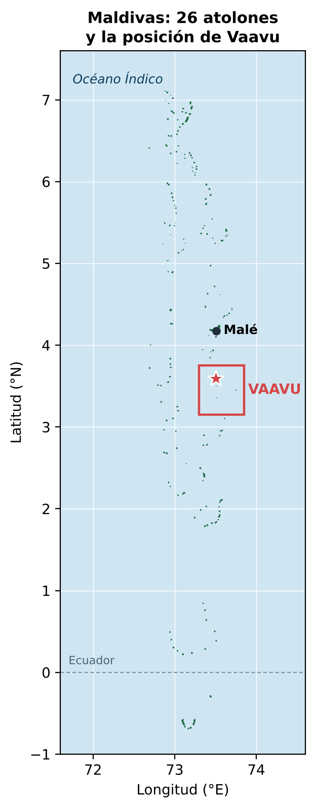 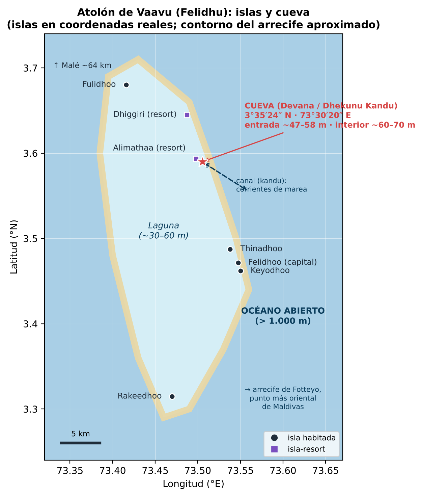

*Izquierda: los 26 atolones naturales de Maldivas y la posición de Vaavu. Derecha: atolón de Vaavu con sus islas (coordenadas reales) y la cueva. Esquemas propios.*

### 4.1 Maldivas: un país hecho de arrecife

- Unas **1.190 islas** agrupadas en **26 atolones naturales**, en el océano Índico, al suroeste de la India, a lo largo de unos 870 km de norte a sur y cruzando el ecuador.
- Es el país **más bajo del mundo**: la altura media del suelo ronda 1,5 m sobre el nivel del mar.
- La palabra **atolón** viene precisamente del idioma de Maldivas, el *dhivehi* (*atholhu*).
- Las islas no son volcanes ni montañas: son **arena de coral** acumulada sobre arrecifes que crecieron encima de una cordillera volcánica hundida (la dorsal de Chagos-Laquedivas).

### 4.2 Cómo se forma un atolón (y por qué hay cuevas)

Charles Darwin propuso en 1842 la explicación que hoy se acepta:

1. Un volcán emerge en un mar tropical y el coral crece en su orilla (**arrecife costero**).
2. El volcán se hunde poco a poco, pero el coral sigue creciendo hacia arriba hacia la luz (**arrecife barrera**).
3. El volcán desaparece bajo el agua y queda solo un **anillo de coral** con una **laguna** en el centro: el **atolón**.

Durante las glaciaciones el nivel del mar bajó más de 100 m. Los arrecifes quedaron al aire, la lluvia disolvió la caliza y excavó **cuevas, voladizos y pasadizos**. Al subir de nuevo el mar, esas cavidades quedaron inundadas en las paredes de los canales. La cueva del accidente es una de ellas.

### 4.3 El atolón de Vaavu (Felidhu)

| Dato | Valor |
|---|---|
| Nombre oficial | Vaavu (en *dhivehi*: Felidhu Atholhu) |
| Composición | Atolón de **Felidhu** + arrecife aislado de **Vattaru** |
| Población | ~1.600 habitantes: el atolón administrativo **menos poblado** del país |
| Capital | **Felidhoo** |
| Islas habitadas | Felidhoo, Fulidhoo, Keyodhoo, Rakeedhoo y Thinadhoo |
| Resorts | **Alimatha** (isla de Alimathaa) y **Dhiggiri** |
| Distancia a Malé | ~64 km: ~1 h en lancha rápida, ~3 h en *dhoni* (barco tradicional) |
| Récord | **Fotteyo**, en su extremo oriental, es el punto más al este de Maldivas |

Vaavu tiene fama entre buceadores porque su borde oriental da al **océano abierto**: el fondo cae a más de mil metros y las corrientes entran y salen por los canales cargadas de plancton, lo que atrae a tiburones, rayas y bancos de peces.

*Felidhoo (atolón de Vaavu), noviembre de 2023. Foto: Z thomas, CC0, vía Wikimedia Commons.*

### 4.4 Kandu, thila, giri: el vocabulario del lugar

El nombre de la cueva ya explica dónde está. En *dhivehi*:

| Palabra | Significado | Por qué importa |
|---|---|---|
| **Kandu** | Canal que atraviesa el anillo del atolón | Por él pasa toda el agua de la marea: **corrientes fuertes** |
| **Thila** | Pináculo de arrecife sumergido, con la cima a unos 10–15 m | Lugar de reunión de peces y tiburones |
| **Giri** | Arrecife que llega casi a la superficie | |
| **Faru** | Arrecife en forma de anillo | |
| **Falhu** | Laguna | |
| **Miyaru** | Tiburón | Por eso el canal vecino se llama *Miyaru Kandu*, «canal de los tiburones» |
| **Dhekunu** | Sur | *Dhekunu Kandu* = «canal del sur» |

**Devana Kandu** es un canal dividido en dos por un *thila* central, al sur de Alimathaa. Las guías de buceo lo describen como **inmersión a la deriva para buceadores avanzados**, con corrientes fuertes que dependen de la marea, paredes con **cuevas, voladizos y corales blandos**, y profundidades recreativas de 5 a 30 m que la corriente puede llevar hasta 40 m. Es **zona marina protegida**. La cueva profunda del accidente se abre más abajo, en la pared del canal.

### 4.5 Por qué la gente va allí

- **Alimatha de noche:** en el embarcadero del resort se reúnen decenas de **tiburones nodriza leonados** y rayas látigo. Es una de las inmersiones nocturnas más conocidas de Maldivas.
- **Canales de tiburones:** en Miyaru Kandu y Devana Kandu se ven grupos de **tiburón gris de arrecife** contra la corriente, además de águilas marinas, barracudas, jureles gigantes y napoleones.
- **Corales blandos:** las paredes de los canales, donde la corriente trae alimento, se cubren de corales blandos y gorgonias de colores.
- **Ciencia:** la Universidad de Génova estudiaba allí los **corales blandos**. La cueva, según el experto ruso Vladimir Tochilov, que la exploró en 2014, tiene **fauna y flora propias que no se ven fuera**, y eso la hacía atractiva para biólogos.

**Cuándo ir:** de diciembre a abril sopla el monzón del noreste (*iruvai*): mar en calma y la mejor visibilidad (a menudo 20–30 m). De mayo a noviembre sopla el monzón del suroeste (*hulhangu*), con más viento, lluvia y oleaje. **El accidente ocurrió justo al empezar el monzón del suroeste**, con aviso amarillo por viento y mar muy agitada, y con mareas vivas por la luna nueva del 16 de mayo.

*Tiburones nodriza en la inmersión nocturna de Alimatha (Vaavu). El archivo los rotula como Ginglymostoma cirratum, la especie del Atlántico; en Maldivas la especie es el tiburón nodriza leonado (Nebrius ferrugineus). Foto: Jun V Lao, CC BY-SA 4.0, vía Wikimedia Commons.*

### 4.6 Qué vida marina encontramos

La luz decide qué vive a cada profundidad. El agua absorbe primero el rojo (unos 5 m), después el naranja, el amarillo y el verde. Por debajo de unos 40 m solo queda azul y el coral que necesita luz desaparece. Dentro de la cueva no llega ninguna luz.

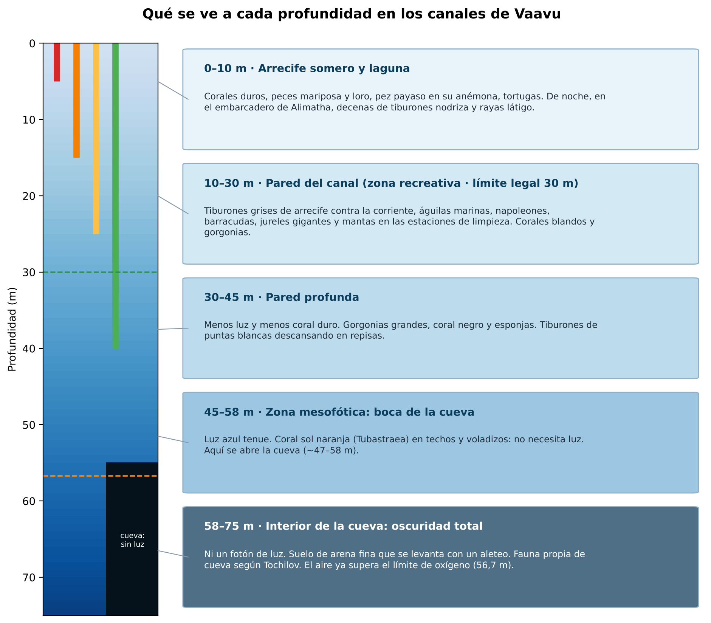

| Especie | Nombre científico | Profundidad | Curiosidad |
|---|---|---|---|
| Tiburón nodriza leonado | *Nebrius ferrugineus* | 5–70 m | De noche en Alimatha; de día descansa en cuevas y bajo voladizos. Había varios durante la recuperación de los cuerpos |
| Tiburón gris de arrecife | *Carcharhinus amblyrhynchos* | 10–60 m | El protagonista de los *kandu*: patrulla en grupo contra la corriente |
| Tiburón de puntas blancas de arrecife | *Triaenodon obesus* | 8–40 m | Descansa de día en cuevas y repisas arenosas |
| Tiburón tigre | *Galeocerdo cuvier* | 0–100 m+ | Interrumpió brevemente la última inmersión de recuperación |
| Águila marina (raya águila) | *Aetobatus ocellatus* | 1–60 m | Vuela en grupos sobre el canal |
| Manta de arrecife | *Mobula alfredi* | 1–40 m | Visita las «estaciones de limpieza» |
| Pez Napoleón | *Cheilinus undulatus* | 5–60 m | Puede superar 1,5 m; en peligro según la UICN |
| Jurel gigante | *Caranx ignobilis* | 10–80 m | Gran cazador de los canales |
| Barracuda | *Sphyraena* spp. | 5–50 m | Forma bancos en espiral |
| Tortuga carey | *Eretmochelys imbricata* | 1–40 m | En peligro crítico |
| Coral sol (coral naranja) | *Tubastraea* spp. | 1–80 m | No hace fotosíntesis: abunda justamente **en la sombra de cuevas y voladizos** |
| Corales blandos | *Dendronephthya* y otros | 5–60 m | Lo que estudiaba la expedición |

*Izquierda: tiburón nodriza leonado (Nebrius ferrugineus) en Maldivas. Foto: Julien Bidet, CC BY-SA 4.0. Derecha: tiburón gris de arrecife, la especie típica de los canales. Foto: Kevin Lino / NOAA, CC BY 2.0. Ambas vía Wikimedia Commons.*

*Izquierda: águila marina (Aetobatus ocellatus) en Maldivas. Foto: Ahmed Abdul Rahman, CC BY-SA 4.0. Derecha: pez Napoleón en Maldivas. Foto: Julien Bidet / MDC Seamarc, CC BY-SA 4.0. Ambas vía Wikimedia Commons.*

*Izquierda: manta de arrecife en Maldivas. Foto: Shiyam ElkCloner, CC BY-SA 3.0. Derecha: coral sol (Tubastraea), típico de techos de cuevas y voladizos. Foto: Franklin Samir Dattein, CC BY 2.0. Ambas vía Wikimedia Commons.*

*Jurel gigante (Dwayne Meadows / NOAA, dominio público), tortuga carey (Thierry Caro, CC BY-SA 3.0) y coral blando Dendronephthya (Alexander Vasenin, CC BY-SA 3.0). Fotos de otros mares del Indo-Pacífico, de especies presentes en Vaavu. Vía Wikimedia Commons.*

### 4.7 La cueva

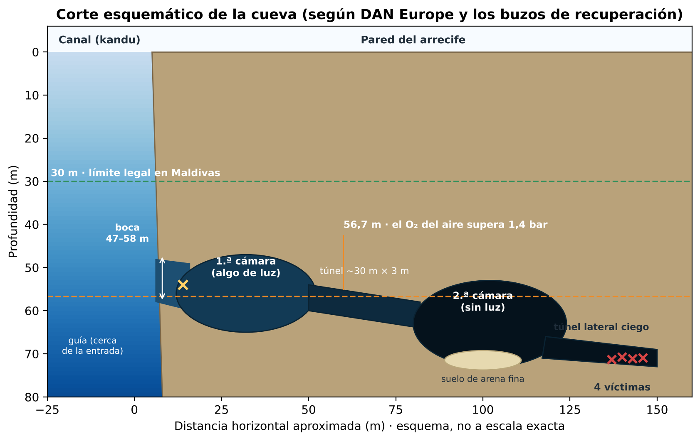

| Elemento | Medida | Fuente |
|---|---|---|
| **Entrada** | ~47 m (CNN, *Open*) · 50–58 m (*Maldives Independent*) · 55–60 m (DAN Europe) | Varía según dónde se mida |
| **1.ª cámara** | Grande, aún con algo de luz natural (caverna) | DAN Europe |
| **Túnel de unión** | ~30 m de largo y ~3 m de ancho | Buzos finlandeses (*Quotidiano Nazionale*) |
| **2.ª cámara** | Grande, **sin luz natural**, suelo de arena fina y sedimento | DAN Europe |
| **Túnel lateral** | Sale de la 2.ª cámara **al lado del túnel de entrada**; es **ciego** y **no estaba en ningún mapa** | DAN Europe, *Maldives Independent* |
| **Profundidad máxima** | ~60–70 m | CNN, *Maldives Independent* |
| **Longitud total** | ~200 m con varias salas | Vladimir Tochilov (CNN) |

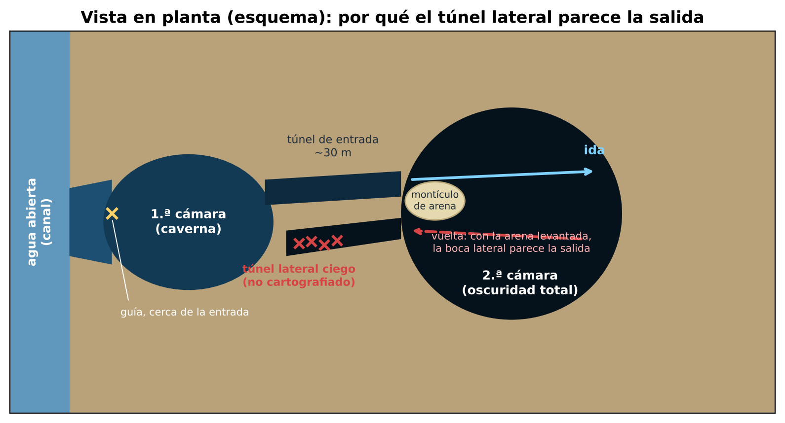

**La trampa, explicada por los buzos que la recorrieron:** al entrar, se cruza la 2.ª cámara pasando junto a un montículo de arena. Al volver, con la arena levantada y la luz de las linternas rebotando en la nube, ese montículo **tapa la boca del túnel correcto**, mientras la boca del túnel lateral, al lado, parece la salida. Los cuatro cuerpos aparecieron juntos al fondo de ese túnel lateral. Benedetti, el guía, apareció cerca de la entrada con la botella vacía: es posible que encontrara la salida o que volviera a buscar a los demás.

---

## 5. Cronología

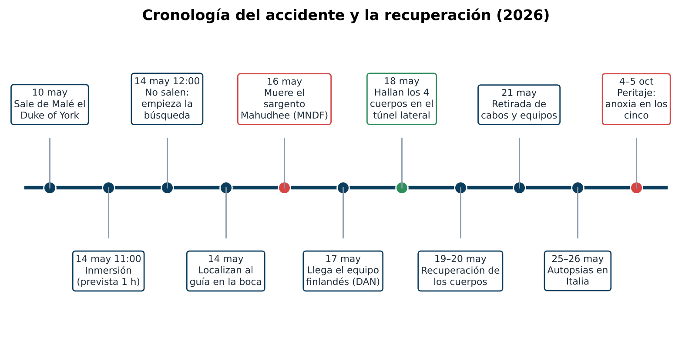

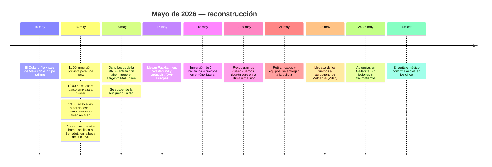

---

## 6. Qué muestran las imágenes

*(Este estudio no reproduce imágenes de las víctimas.)*

1. **Las imágenes de DAN Europe** (difundidas el 22 de mayo): grabadas por el equipo finlandés con sus focos, muestran el recorrido desde la 1.ª cámara, todavía con luz azulada, hasta la 2.ª cámara, completamente negra, con el suelo de arena clara. Se ve bien por qué la salida no es evidente al volver.
2. **La GoPro de las víctimas:** se recuperó dentro de la cueva. Junto con los **ordenadores de buceo** (que registran profundidad y tiempo segundo a segundo), es la «caja negra» del accidente. En octubre de 2026 la fiscalía de Roma seguía pidiendo a Maldivas que le entregara esos equipos.
3. **Lo que no se sabe todavía:** cuánto tiempo pasaron dentro, a qué profundidad exacta estuvieron y en qué momento se perdieron. Todo eso saldrá de los ordenadores y de la cámara si las autoridades publican el análisis.

> 🔍 **Matiz importante:** las imágenes que circularon por redes con el título «la cueva de la muerte» son las de los **rescatadores**, no de las víctimas.

---

## 7. Por qué murieron: análisis punto por punto

Los números de esta sección son cálculos propios, hechos con fórmulas estándar del buceo y comprobados con un script en Python ([`scripts/calculos_y_figuras.py`](scripts/calculos_y_figuras.py), resultados en [`calculos.txt`](calculos.txt)).

### 7.1 La presión (ley de Boyle)

En el mar, cada **10 m** de profundidad añaden **1 bar** de presión, más 1 bar de la atmósfera.

$$P_{\text{absoluta}} = 1 + \frac{\text{profundidad (m)}}{10}$$

| Profundidad | Presión absoluta | Un litro de aire de superficie ocupa… |
|---|---|---|
| 0 m | 1 bar | 1 L |
| 30 m (límite en Maldivas) | 4 bar | 0,25 L |
| 47 m (entrada, según CNN) | 5,7 bar | 0,18 L |
| **60 m** (interior) | **7 bar** | **0,14 L** |
| 69 m (donde se halló a Mahudhee) | 7,9 bar | 0,13 L |

**Consecuencia:** a 60 m cada respiración gasta **siete veces** más aire de la botella que en superficie.

### 7.2 La narcosis por nitrógeno («borrachera de las profundidades»)

El aire es un **79 % nitrógeno**. Según la **ley de Dalton**, cada gas de una mezcla aporta su parte de la presión total (su **presión parcial**). Según la **ley de Henry**, cuanto mayor es esa presión parcial, más gas se disuelve en la sangre y en el cerebro.

- Presión parcial de nitrógeno a 60 m: 0,79 × 7 ≈ **5,5 bar**, siete veces la de superficie.
- Regla informal de la **«ley del Martini»**: cada 10 m por debajo de 20 m equivale a un martini. A 60 m: **unos 4 martinis**.
- Efectos: euforia, exceso de confianza, visión de túnel, lentitud para pensar, fijación en una idea.

> 🧠 **Por qué importa aquí:** en una cueva hay que **recordar el camino**, **contar el gas** y **decidir cuándo girar**. La narcosis ataca justo esas tres cosas, y no avisa. John Volanthen, buzo del rescate de la cueva de Tailandia en 2018, lo explicó así a CNN: la narcosis «puede provocar pánico, pero también hacer menos probable que encuentren la salida».

### 7.3 El oxígeno se vuelve tóxico

El oxígeno es **tóxico** para el sistema nervioso central cuando su presión parcial (**ppO₂**) es demasiado alta. Puede provocar **convulsiones sin aviso**; bajo el agua, una convulsión suele hacer soltar el regulador.

- Límite de trabajo: **1,4 bar**. Máximo de contingencia: **1,6 bar**.
- **Profundidad máxima operativa (MOD)** del aire: 10 × (1,4 / 0,21 − 1) ≈ **56,7 m** · con 1,6 bar ≈ **66 m**.
- ppO₂ del aire a 60 m: 0,21 × 7 ≈ **1,47 bar** (por encima del límite de trabajo). A 69 m: **1,66 bar** (por encima del máximo).

> 💡 **Dato revelador:** la cueva está **justo en la franja donde el aire deja de ser seguro**. La entrada queda por encima de los 56,7 m; el interior, por debajo.
>
> **¿Y si llevaban nitrox?** Algunos medios italianos publicaron que las botellas tenían **nitrox 28** (28 % de oxígeno). Con esa mezcla, a 60 m la ppO₂ sería de **1,96 bar**, muy por encima del máximo. No está confirmado: la mayoría de las fuentes hablan de **aire normal**.

### 7.4 La densidad del gas y el CO₂

A 7 bar, el aire es **siete veces más denso**: unos **8,6 g/L** (frente a 1,2 g/L en superficie).

- Anthony y Mitchell (2016) recomiendan no pasar de **5,2 g/L** y nunca de **6,2 g/L**. Con aire, esos límites se alcanzan a unos **32 m** y **41 m**.
- Un gas tan denso circula mal por los bronquios. Cuesta más moverlo y el **CO₂ se acumula** (**hipercapnia**).
- El exceso de CO₂ produce **sensación de ahogo y ansiedad**, **empeora la narcosis** y **aumenta el riesgo de toxicidad del oxígeno**.

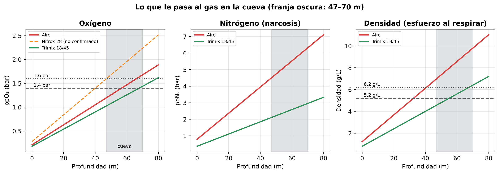
*Presión parcial de oxígeno, presión parcial de nitrógeno y densidad del aire según la profundidad. La franja oscura es la zona de la cueva. Cálculo propio.*

> 🔄 **El círculo vicioso:** gas denso → CO₂ acumulado → ahogo → respiración más rápida → más CO₂ y más gasto de aire → pánico. Cuando alguien se pierde a oscuras, este círculo se dispara.

### 7.5 Cuánto dura una botella a 60 m

| Situación | Consumo en superficie (SAC) | Consumo a 60 m | Minutos con una botella de 12 L a 200 bar (2.400 L) |
|---|---|---|---|
| Muy relajado | 15 L/min | 105 L/min | **≈ 23 min** |
| Normal | 20 L/min | 140 L/min | **≈ 17 min** |
| Esfuerzo | 30 L/min | 210 L/min | **≈ 11 min** |
| Estrés | 45 L/min | 315 L/min | **≈ 8 min** |
| Pánico | 60 L/min | 420 L/min | **≈ 6 min** |

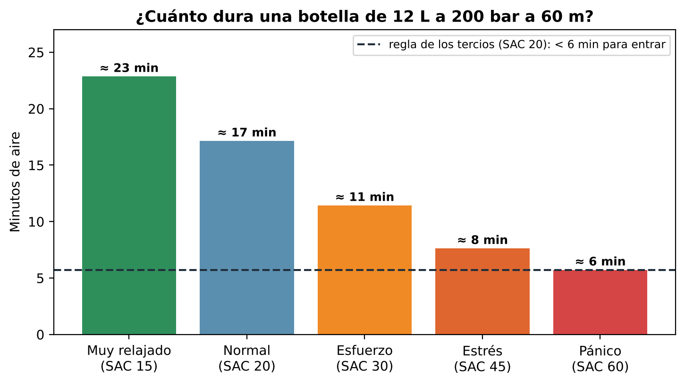

*Estimación propia con la botella de 12 L que citan los informes. Coincide con lo que dijeron los expertos: DAN Europe habló de **10–12 minutos** de autonomía «con ese tipo de botellas», y Patrik Grönqvist, de unos **diez minutos**.*

**Y eso contando el gas total de la botella**, sin descontar el que hace falta para bajar, para subir ni para las paradas.

### 7.6 La descompresión: aunque hubieran salido, no había gas para subir

A 60 m el cuerpo absorbe nitrógeno muy deprisa. Para no sufrir una **enfermedad descompresiva** hay que subir despacio y hacer **paradas de descompresión**. Con un modelo estándar (Bühlmann ZH-L16C, factores de gradiente 30/85, consumo normal), **solo con fines divulgativos**:

| Tiempo a 60 m | Duración del ascenso | Gas total necesario | Gas disponible |
|---|---|---|---|
| 20 min | ≈ 68 min | ≈ 5.200 L | 2.400 L |
| 30 min | ≈ 129 min | ≈ 8.800 L | 2.400 L |
| 45 min | ≈ 250 min (más de 4 h) | ≈ 15.200 L | 2.400 L |

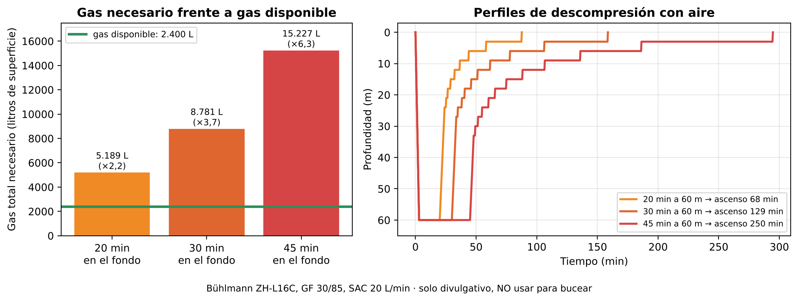

> ⚖️ **Conclusión:** con una sola botella de 12 L **no existe ningún plan posible** para hacer esa inmersión con seguridad. El gas necesario es entre **2 y 6 veces** el que llevaban. El error decisivo no estuvo dentro de la cueva, sino **antes de entrar al agua**. ⚠️ No uses estas cifras para planificar una inmersión real.

### 7.7 Perderse en una cueva: oscuridad, sedimento y un túnel sin mapa

Este es el punto que, según DAN Europe, explica lo ocurrido.

1. **Sin luz natural no hay referencia.** Edd Sorenson, especialista en rescate en cuevas, lo explicó a *The Guardian*: «Las cuevas no son oscuras: no tienen luz. Tu casa de noche está oscura. Si en una cueva se te apaga la linterna, no hay nada». El ojo no se acostumbra porque no hay ni un fotón.
2. **El sedimento («silt-out»).** El suelo de la 2.ª cámara es arena fina. Un aleteo normal de aguas abiertas (*flutter kick*, de arriba abajo) junto al fondo la levanta y la visibilidad pasa de perfecta a **cero en segundos**. En cuevas se usa el **aleteo de rana** (*frog kick*), que empuja el agua hacia atrás y no hacia abajo.
3. **Sin hilo guía.** Los informes coinciden en que **no se usó hilo guía**. En espeleobuceo es la regla número uno: un **hilo continuo desde el agua abierta** hasta el punto más lejano. Si se pierde la visibilidad, se sigue el hilo **a tientas** hasta la salida.
4. **El montículo y el túnel gemelo.** La boca del túnel correcto quedaba tapada por el montículo de arena, y la del túnel lateral, al lado, parecía la salida (ver [§4.7](#47-la-cueva)).
5. **Un túnel que no estaba en ningún mapa.** Sami Paakkarinen encontró a las víctimas siguiendo **marcas en la arena** en un túnel no cartografiado. Por eso pidió después que la cueva se topografíe bien.

### 7.8 ¿Una corriente los arrastró?

El médico hiperbárico italiano Pasquale Longobardi (SIMSI) propuso que una corriente inesperada, reforzada por el inicio del monzón y por las mareas vivas, pudo empujarlos hacia dentro (**efecto Venturi**: el agua acelera al pasar por un estrechamiento). **No está confirmado.** DAN Europe no la menciona, y los buceadores que conocían la cueva dicen que normalmente no tiene corrientes importantes. Es una hipótesis abierta, con confianza baja (0,3).

### 7.9 El factor humano

- **Exceso de confianza.** Laura Marroni, de DAN Europe, lo resumió en una palabra: *overconfidence*. Ser muy bueno en aguas abiertas no es ser bueno en cuevas.
- **Autoridad dentro del grupo.** Cuando en un grupo hay una profesora con 5.000 inmersiones y un instructor que conoce la zona, a los demás les cuesta decir «esto no». En aviación se llama **gradiente de autoridad**.
- **El grupo es tan seguro como su miembro menos preparado.** Cinco personas en una cueva son cinco nubes de arena y cinco consumos distintos.
- **Normalización del riesgo.** Si una inmersión «arriesgada» ha salido bien otras veces, el riesgo deja de parecerlo.
- **Objetivo fijo.** Ver una fauna que no existe fuera de la cueva era un motivo científico real, y eso empuja a seguir.

---

## 8. La cadena de errores

En seguridad se usa el **modelo del queso suizo**: un accidente rara vez tiene una sola causa. Ocurre cuando los agujeros de varias capas de protección se alinean.

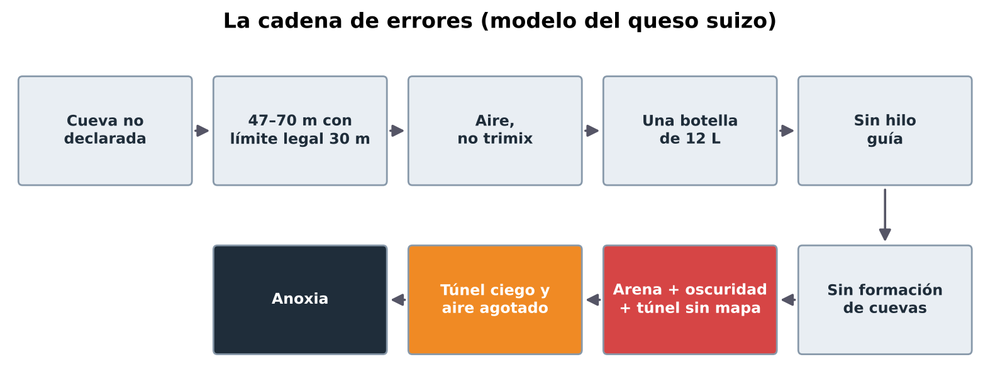

```mermaid
flowchart LR
    A["1️⃣ Planificación<br/>Inmersión en cueva<br/>no declarada"] --> B["2️⃣ Profundidad<br/>47–70 m con límite<br/>legal de 30 m"]
    B --> C["3️⃣ Gas<br/>Aire, no trimix"]
    C --> D["4️⃣ Equipo<br/>Una botella de 12 L,<br/>sin redundancia"]
    D --> E["5️⃣ Sin hilo guía"]
    E --> F["6️⃣ Formación<br/>Sin título conocido<br/>de espeleobuceo"]
    F --> G["7️⃣ Entorno<br/>Arena + oscuridad<br/>+ túnel sin mapa"]
    G --> H["8️⃣ Túnel ciego<br/>y aire agotado"]
    H --> I["💀 Anoxia"]
    style G fill:#d64545,color:#fff
    style I fill:#222,color:#fff
```

| Eslabón | ¿Comprobado? | Confianza |
|---|---|---|
| La cueva no estaba en el permiso y el Gobierno no sabía el lugar exacto | Sí (portavoz del Gobierno, *Open*, *Maldives Independent*) | 0,9 |
| Profundidad de 47–70 m, por encima del límite de 30 m | Sí (todas las fuentes) | 0,95 |
| Aire comprimido normal y botellas de 12 L | Muy probable (DAN, IVG, Divernet, *Maldives Independent*) | 0,8 |
| Sin hilo guía | Probable (Wikipedia, *Divevolk*, buzos finlandeses) | 0,75 |
| Sin formación de espeleobuceo completa | Probable; la única cifra pública es un nivel básico de caverna en uno de ellos | 0,6 |
| Desorientación y túnel lateral equivocado | Sí: hipótesis preliminar de DAN y posición de los cuerpos | 0,85 |
| Muerte por agotamiento del aire (anoxia) | Sí: peritaje médico | 0,9 |
| Corriente que los arrastró | No confirmado | 0,3 |
| Toxicidad del oxígeno como causa directa | Posible solo si llevaban nitrox; no confirmado | 0,3 |

---

## 9. Cómo se podría haber evitado

Cada fila es una capa del queso suizo. **Con que una sola hubiera funcionado, lo más probable es que hoy estuvieran vivos.**

| Lo que pasó | Lo que se hace en una inmersión en cueva bien planificada | Qué lo habría evitado |
|---|---|---|
| Inmersión en cueva no declarada | Plan escrito, permiso específico de exploración profunda y aviso a las autoridades del punto exacto | Las autoridades lo habrían denegado o habrían exigido equipo técnico |
| 60 m con aire | **Trimix** (oxígeno + helio + nitrógeno), por ejemplo **18/45** (18 % O₂, 45 % He): a 60 m da ppO₂ ≈ 1,26 bar y una narcosis equivalente a unos 23 m | Cabeza clara para navegar y decidir |
| Una botella de 12 L | **Dos botellas independientes** (bibotella o *sidemount*) + **botellas de etapa** con gas de descompresión, o **rebreather** con botellas de rescate (*bailout*) | Gas suficiente para volver y para descomprimir |
| Sin plan de gas | **Regla de los tercios:** 1/3 para entrar, 1/3 para salir y 1/3 de reserva para un compañero. A 60 m con 12 L y consumo normal, eso deja **menos de 6 minutos** para entrar | La regla habría dicho «no» antes de mojarse |
| Sin hilo guía | **Hilo continuo** desde el agua abierta, con carrete; **flechas** de dirección apuntando a la salida y **marcadores personales** | Habrían salido a tientas siguiendo el hilo |
| Aleteo normal | **Aleteo de rana** y control de flotabilidad perfecto, lejos del fondo | Sin nube de arena, la salida se habría visto |
| Una linterna | **Regla de las tres luces:** una principal y dos de reserva por buceador | Nunca a oscuras |
| Grupo de cinco con niveles distintos | Equipos de **2 o 3** buceadores con la **misma formación**, señales acordadas y orden fijo | Más control y menos sedimento |
| Formación de aguas abiertas | Escalera de formación: **caverna → introducción a cuevas → cueva completa**, más trimix y descompresión | Las técnicas que les faltaron |
| Cueva sin mapa completo | Topografía previa o inmersión de reconocimiento con un guía que la conozca | Saber que había un túnel gemelo |
| Mal tiempo y mareas vivas | Suspender la inmersión. Cristina Zenato, instructora de cuevas: «Me he sentado al borde del agua y he dicho *hoy no*» | Más margen ante una corriente o un problema |
| Barco sin licencia de escuela | Operador con licencia y protocolo de emergencia, oxígeno y evacuación a cámara hiperbárica | Rescate más rápido y seguro |

*Buceador de cuevas desenrollando un hilo guía desde el agua abierta hacia el interior. Es la técnica básica que, según los informes, no se usó. Foto: Ryan Cantey, CC BY-SA 3.0, vía Wikimedia Commons.*

*Izquierda: buceador con configuración «sidemount» (botellas a los costados), muy usada en cuevas. Foto: Pete Nawrocky, CC BY-SA 3.0. Derecha: rebreather de circuito cerrado, el tipo de equipo que usó el equipo finlandés. Foto: EMDX, CC BY-SA 4.0. Ambas vía Wikimedia Commons.*

---

## 10. La recuperación y la sexta víctima

### 10.1 El intento de la MNDF y la muerte del sargento Mahudhee

El sábado 16 de mayo, un equipo de **ocho buzos** de la Guardia Costera maldiva (MNDF) entró en la cueva **con aire y equipo estándar**: el mismo tipo de equipo que había fallado dos días antes. Según la reconstrucción del *Maldives Independent*:

- Se le soltó el bolsillo donde llevaba su **carrete de hilo guía**, se separó del grupo y siguió a otro buzo hasta la 2.ª cámara.
- Lo encontraron a **69 m** con la botella vacía y el regulador fuera de la boca. Estuvo desaparecido **al menos 75 minutos**.
- A 69 m con aire: ppO₂ = **1,66 bar** (por encima del máximo) y densidad ≈ **9,7 g/L**.
- El certificado de defunción habla de **embolia gaseosa arterial cerebral** por ascenso rápido. Su familia lo discute: los informes del hospital indican que llegó **sin pulso** y un médico de buceo que los revisó cree que **ya había muerto en la cueva**. No se le hizo autopsia.
- Los propios mandos de la MNDF reconocieron que sus buzos solo están titulados hasta **50 m**. No había cámara hiperbárica en el lugar.

> 🧭 **La regla más dura del rescate:** **no crear más víctimas.** Un rescatador que entra en las mismas condiciones que causaron el accidente corre el mismo riesgo. El equipo internacional llegaba al día siguiente. Recuperar cuerpos nunca justifica arriesgar a los vivos.

### 10.2 El equipo finlandés de DAN Europe

| Aspecto | Dato |
|---|---|
| Buzos | **Sami Paakkarinen, Jenni Westerlund y Patrik Grönqvist** |
| Experiencia | Los mismos que en 2014 recuperaron a dos buceadores muertos en la cueva de **Plura** (Noruega), a más de 100 m |
| Equipo | **Rebreathers** de circuito cerrado, **propulsores submarinos** (*scooters*) y sistemas de soporte vital duplicados |
| Apoyo | Equipos de buzos maldivos a profundidad media y somera; material especializado de Reino Unido y Australia |
| Inmersiones | Unas **3 horas** cada una; en la última, unos 50 minutos de trabajo dentro de la cueva |
| Hallazgo | El 18 de mayo, con unos **5 minutos** de margen antes de tener que salir |
| Método | Subían los cuerpos hasta **~30 m** en camilla y allí los relevaban los buzos maldivos |
| Fauna | Tiburones nodriza durante las primeras recuperaciones y un **tiburón tigre** que interrumpió brevemente la última |
| Reconocimiento | El presidente italiano Sergio Mattarella les concedió la **Orden del Mérito** |

Jenni Westerlund describió así el método: «Usamos *scooters*. Uno guiaba y abría camino; el otro asistía, controlaba y se ocupaba de la carga. Hay pasos estrechos en los que apenas te mueves y de pronto se abre una zona amplia».

---

## 11. Permisos, responsabilidades e investigación

### 11.1 Qué permitía la ley

| Norma o permiso | Qué decía |
|---|---|
| Reglamento de buceo recreativo de Maldivas (2003) | Límite de **30 m** |
| Permiso de investigación de la Universidad de Génova | Del 3 al 17 de mayo, en seis atolones incluido Vaavu, para estudiar corales blandos **hasta 50 m**. **No mencionaba cuevas** ni puntos concretos, y **no incluía a dos** de los fallecidos |
| Licencia del *Duke of York* | Solo **recreativa (30 m)**. Según el Gobierno, le faltaba la **licencia de escuela de buceo** necesaria para organizar expediciones |
| Permiso de exploración profunda | El único camino legal para entrar en esa cueva. **No lo tenían** |
| Buceo técnico | Maldivas **no tenía ninguna regulación** que distinguiera el buceo técnico del recreativo por debajo de 30 m |

### 11.2 Quién dice qué

- **Gobierno de Maldivas** (portavoz Mohamed Hussain Shareef): no les dijeron que entrarían en una cueva; de haberlo sabido, habrían dado «directrices mucho más claras». Suspendió la licencia del barco.
- **Operador del barco** (Abdul Muhsin Moosa): el barco tenía permiso recreativo hasta 30 m.
- **Albatros Top Boat**, el turoperador italiano que fletó el viaje (abogada Orietta Stella): nunca autorizó una penetración en cueva a 50 m y las inmersiones las organizaban los investigadores.
- **Universidad de Génova:** la inmersión fue privada; las inmersiones en misiones científicas estaban prohibidas desde marzo de 2024.
- **Abogados de la familia Gualtieri:** «No se sabe quién organizó la inmersión, con qué fines ni con qué equipo».

### 11.3 Las investigaciones

- **Italia:** la fiscalía de Roma abrió el 19 de mayo una investigación por **homicidio imprudente**, sin nadie señalado públicamente. Envió una comisión rogatoria a Maldivas para recuperar ordenadores de buceo, cámaras y botellas.
- **Maldivas:** investiga si los responsables tomaron las precauciones adecuadas. En agosto no había informe público.
- **Nueva ley:** el 23 de mayo el Gobierno anunció una ley de **buceo técnico y en pecios** (*Tech-Wreck*): permisos solo para investigadores y buceadores técnicos muy titulados, con equipo especializado y «directrices muy estrictas». La MNDF prevé formar a sus buzos hasta 100 m antes de terminar 2026.

---

## 12. Hipótesis: descartadas y abiertas

| Hipótesis | Estado | Razonamiento |
|---|---|---|
| Ataque de tiburón | ❌ Descartada | Sin lesiones de fauna en las autopsias. Los tiburones nodriza de la zona son tranquilos |
| Aire contaminado con monóxido de carbono | ❌ Descartada según *Geopop* | Sin CO ni otras sustancias en los análisis. *Divernet* decía el 9 de octubre que la toxicología seguía pendiente: hay que confirmarlo |
| Narcosis como causa **única** | ❌ No basta | Desaparece al subir; no explica por sí sola que cinco personas no encontraran la salida. Sí es un **factor agravante** |
| Toxicidad del oxígeno | ⚠️ «Descartada» según *Geopop*, pero… | Una convulsión por oxígeno **no deja huella** en una autopsia. Solo es plausible si llevaban nitrox. Confianza baja (0,3) |
| **Desorientación y túnel equivocado** | ✅ La más probable | Posición de los cuerpos, informe de DAN y descripción de los finlandeses (0,85) |
| **Agotamiento del aire** | ✅ Confirmado | Anoxia en los cinco y botella vacía de Benedetti (0,9) |
| Corriente que los arrastró | ❓ Abierta | Monzón y mareas vivas a favor; testimonios de buceadores en contra (0,3) |
| Pánico que aceleró el consumo | ❓ Muy probable como agravante | Física del consumo (ver [§7.5](#75-cuánto-dura-una-botella-a-60-m)) |

---

## 13. Mitos frente a realidad

| Mito | Realidad | Confianza |
|---|---|---|
| «Eran principiantes» | Eran muy expertos en aguas abiertas, pero no consta formación completa en cuevas | 0,85 |
| «Se quedaron sin oxígeno» | Se quedaron sin **aire**. El oxígeno puro sería tóxico a 60 m | 0,9 |
| «Les atacó un tiburón» | Ninguna lesión de fauna | 0,95 |
| «Era una inmersión de la universidad» | La universidad lo niega; el permiso no cubría cuevas | 0,7 |
| «La cueva tiene una corriente asesina» | Hipótesis sin confirmar; normalmente no tiene corrientes fuertes | 0,7 |
| «El rescatador murió de descompresión» | Es lo que dijo el Gobierno el primer día; el hospital y la familia apuntan a que murió dentro de la cueva | 0,6 |
| «Las imágenes muestran a las víctimas» | Son imágenes de los rescatadores | 0,9 |

---

## 14. Contraste de fuentes: datos que no coinciden

| Dato | Versión A | Versión B | Más probable y por qué |
|---|---|---|---|
| **Nombre de la cueva** | Dhekunu Kandu (DAN, Wikipedia) | Devana Kandu (prensa maldiva), Thinwana Kandu, «cueva de los tiburones» | **Es la misma cueva**; los nombres vienen del canal y de sus variantes en *dhivehi* |
| **Profundidad de la entrada** | ~47 m (CNN, *Open*) | 55–60 m (DAN) | **47–60 m**: depende de si se mide el techo o el suelo de la boca |
| **Dónde hallaron los 4 cuerpos** | «Tercera cámara» (CNN, *The Standard* de Maldivas) | Túnel lateral de la 2.ª cámara (DAN) | **El túnel lateral**: la prensa lo llamó «tercera cámara» |
| **Dónde estaba Benedetti** | En la boca de la cueva (CNN, Gobierno) | A ~60 m en la 1.ª o 2.ª cámara (prensa italiana) | **1.ª cámara / cerca de la entrada** |
| **Cuándo se recuperó a Benedetti** | El mismo 14 de mayo (Divernet, CNN) | El 15 de mayo (*Maldives Independent*) | Lo **localizaron** el 14; la **recuperación** pudo terminar el 15 |
| **Gas** | Aire (DAN, *Geopop*, *Maldives Independent*) | Nitrox 28 (algunos medios italianos) | **Aire**, mientras no se publique el análisis de las botellas |
| **Edad de Montefalcone / Sommacal** | 51 / 23 (*Maldives Independent*) | 52 / 20 (*Il Sole 24 Ore*) | Sin confirmar |
| **Causa de la muerte de Mahudhee** | Enfermedad descompresiva (Gobierno, primer día) | Muerte en la cueva; embolia o cambios post mortem (hospital, familia) | **Sin determinar** |
| **Toxicología** | Negativa (*Geopop*, octubre) | Pendiente (*Divernet*, 9 octubre) | Probablemente terminada a principios de octubre |

---

## 15. Glosario técnico

| Término | Significado |
|---|---|
| **Aleteo de rana** (*frog kick*) | Patada horizontal que empuja el agua hacia atrás; no levanta sedimento |
| **Anoxia** | Falta total de oxígeno en los tejidos. Aquí, porque se acabó el aire |
| **Atolón** | Anillo de arrecife de coral con una laguna en el centro. La palabra viene del *dhivehi* |
| **bar** | Unidad de presión. 1 bar ≈ presión de la atmósfera al nivel del mar |
| **Bailout** | Botella de rescate que lleva quien bucea con rebreather |
| **Bibotella** | Dos botellas unidas en la espalda con dos reguladores independientes |
| **Botella de etapa** (*stage*) | Botella extra al costado, con gas para una fase concreta |
| **Buceo recreativo** | Sin paradas de descompresión obligatorias; en Maldivas, hasta 30 m |
| **Buceo técnico** | Más allá de los límites recreativos: más profundidad, gases especiales, descompresión o techo |
| **Caverna** | Zona de una cueva donde aún se ve la luz del exterior |
| **Ley de Boyle, de Dalton y de Henry** | Leyes de los gases: volumen y presión; presiones parciales; gas disuelto en la sangre |
| **CO₂ / hipercapnia** | Exceso de dióxido de carbono en sangre: ahogo, ansiedad, confusión |
| **Densidad del gas** | Masa por litro del gas respirado; a más profundidad, más difícil respirar |
| **Descompresión** (paradas de) | Paradas en el ascenso para eliminar el nitrógeno sin formar burbujas |
| **DAN** (*Divers Alert Network*) | Organización internacional de seguridad y medicina del buceo |
| **Efecto Venturi** | Aceleración del agua al pasar por un estrechamiento |
| **Embolia gaseosa arterial** | Burbujas de gas en las arterias, normalmente por subir rápido con aire en los pulmones |
| **Enfermedad descompresiva** (EDC) | Lesiones por burbujas de nitrógeno al subir demasiado rápido |
| **Espeleobuceo** | Buceo en cuevas inundadas |
| **Gradiente de autoridad** | Dificultad para cuestionar a quien tiene más rango o experiencia |
| **Hilo guía** | Cabo continuo desde el agua abierta que marca el camino de vuelta |
| **Kandu / thila / giri / faru** | Canal / pináculo sumergido / arrecife casi en superficie / arrecife en anillo |
| **Liveaboard** | Barco crucero en el que se vive durante días para bucear |
| **MNDF** | Fuerza Nacional de Defensa de Maldivas, de la que depende la Guardia Costera |
| **MOD** | Profundidad máxima operativa de una mezcla según su ppO₂ |
| **Monzón** | Viento estacional: *iruvai* (noreste, dic.–abr.) y *hulhangu* (suroeste, may.–nov.) |
| **Narcosis por nitrógeno** | Efecto anestésico del nitrógeno a presión; parece una borrachera |
| **Nitrox** | Aire enriquecido con más del 21 % de oxígeno; no sirve para 60 m |
| **Presión parcial** (ppO₂, ppN₂) | La parte de la presión total que corresponde a cada gas |
| **Rebreather** (CCR) | Equipo que recicla el gas espirado y repone el oxígeno; gasta muy poco gas |
| **Regla de los tercios** | Un tercio del gas para entrar, uno para salir y uno de reserva |
| **Regla de las tres luces** | Una linterna principal y dos de reserva |
| **SAC** | Consumo de gas por minuto en litros de superficie |
| **Sidemount** | Botellas sujetas a los costados del cuerpo; útil en pasos estrechos |
| **Silt-out** | Pérdida total de visibilidad por el sedimento levantado |
| **Toxicidad del oxígeno (SNC)** | Efecto del oxígeno sobre el cerebro por encima de ~1,4–1,6 bar: convulsiones |
| **Trimix** | Mezcla de oxígeno, helio y nitrógeno para inmersiones profundas |
| **Zona de luz** | Parte de la cueva desde la que aún se ve la salida |

---

## 16. Lecciones para cualquier buceador

1. **Una cueva es otro deporte.** La experiencia en aguas abiertas no sirve dentro.
2. **Sin hilo guía, no se entra.** Nunca.
3. **Calcula el gas antes de mojarte.** Si la regla de los tercios te deja cinco minutos, la respuesta es no.
4. **El aire tiene límite:** por densidad del gas hacia 32–41 m y por oxígeno hacia 57–66 m.
5. **Respeta la ley del lugar.** En Maldivas el límite es 30 m por algo.
6. **Cualquiera puede decir «hoy no»**, aunque sea el menos experto del grupo.
7. **En un rescate, la primera vida es la del rescatador.**
8. **Ver algo único nunca vale una vida.**

---

## 17. Metodología, límites y nivel de confianza

**Cómo se ha hecho:**

1. Se ha dividido el caso en partes: hechos, lugar, cueva, física, fisiología, navegación, factor humano, rescate, responsabilidades y mitos.
2. Cada dato se ha contrastado con al menos dos fuentes independientes cuando ha sido posible, en inglés, italiano y español. Las discrepancias están en la [§14](#14-contraste-de-fuentes-datos-que-no-coinciden).
3. Los cálculos (presiones, ppO₂, MOD, densidad, autonomía, descompresión) se han hecho con fórmulas estándar y se pueden reproducir con el script del repositorio.
4. Todo el texto es redacción propia: no copia párrafos de ninguna fuente. Las citas literales van entre comillas y con su autor.
5. **Comprobación de originalidad (31/10/2026):** se buscaron en internet frases literales del documento y análisis parecidos, sin encontrar coincidencias. Existen análisis técnicos en inglés (*Divevolk*, sobre la hipótesis del nitrox; artículos tipo «Anatomy of deep cave diving disasters: the Vaavu Atoll cascade» replicados en varias webs), reportajes en español como el de *¡Hola!* sobre «la trampa invisible» de la arena, y artículos de prensa, pero no se ha encontrado ningún estudio en español que reúna la geografía de Vaavu, la física con cálculos de descompresión, la recuperación, las responsabilidades, el contraste de fuentes y el glosario.

**Límites:**

- No se han publicado los datos de los ordenadores de buceo ni el vídeo de la GoPro. La secuencia exacta **no se conoce**.
- No hay informe oficial final ni de Maldivas ni de Italia.
- No se conoce con certeza la formación de cada víctima.
- Los cálculos de descompresión son **divulgativos** y no deben usarse para bucear.

**Confianza global del estudio:**

| Bloque | Confianza |
|---|---|
| Hechos básicos (quién, cuándo, dónde, profundidad) | 0,9 |
| Física y fisiología (cálculos) | 0,95 |
| Geografía y vida marina de la zona | 0,85 |
| Causa médica (anoxia) | 0,9 |
| Secuencia exacta dentro de la cueva | 0,6 |
| Responsabilidades | 0,4 (investigación abierta) |

---

## 18. Fuentes

**El accidente y la investigación**

- Wikipedia (en). *2026 Dhekunu Kandu cave diving incident*. https://en.wikipedia.org/wiki/2026_Dhekunu_Kandu_cave_diving_incident
- DAN Europe (22/05/2026). *Dhekunu Kandu: official statement and preliminary reconstruction*. https://www.daneurope.org/en/-/dan-supporta-le-operazioni-internazionali-di-search-recovery-alle-maldive
- Harvey, L. y Chernova, A. (20/05/2026). *Five cave divers slipped beneath the waves in the Maldives. Why didn't they resurface?* **CNN**. https://www.cnn.com/2026/05/20/world/maldives-cave-dive-narrative-dst-intl-hnk
- Yang, M. (23/05/2026). *'If something goes wrong, you can't simply surface'*. **The Guardian**. https://www.theguardian.com/world/2026/may/23/maldives-diving-tragedy-cave-experts-warn-danger-safety
- **Maldives Independent**. *The Devana Kandu tragedy: criminal probe, regulatory gaps, and the questions left unanswered*. https://maldivesindependent.com/explainer/the-devana-kandu-tragedy-criminal-probe-regulatory-gaps-and-the-questions-left-unanswered-e441
- **Maldives Independent**. *Five weeks after the Devana Kandu deaths*. https://maldivesindependent.com/society/five-weeks-after-the-devana-kandu-deaths-what-the-recovery-divers-saw-and-what-investigators-want-b816
- **Maldives Independent**. *The death of Sgt Mahudhee: what the records show*. https://maldivesindependent.com/explainer/the-death-of-sgt-mahudhee-what-the-records-show-15d6
- **Divernet** (09/10/2026). *Italian divers who died in Maldives cave ran out of gas*. https://divernet.com/scuba-news/health-safety/death/italian-divers-who-died-in-maldives-cave-ran-out-of-gas/
- **DeeperBlue**. *DAN Europe: Divers in Maldives cave incident lost their way*. https://deeperblue.com/dan-europe-provides-details-over-tragic-maldives-cave-incident
- **Quotidiano Nazionale** (22/05/2026). *Maldive, i sub finlandesi ipotizzano un errore umano*. https://www.quotidiano.net/cronaca/maldive-errore-umano-hanno-sbagliato-strada-uscendo-dalla-grotta-awgd117f
- **IVG** (05/2026). *Tragedia alle Maldive, le prime immagini della grotta e la relazione del team di recupero*. https://www.ivg.it/2026/05/tragedia-alle-maldive-le-prime-immagini-della-grotta-e-la-relazione-del-team-di-recupero-presto-le-autopsie/
- **Il Giorno**. *Maldive, i 4 fattori della trappola*. https://www.ilgiorno.it/cronaca/maldive-4-fattori-della-trappola-jzlc247j
- **Open** (18/05/2026). *Maldive, sub morti: le autorizzazioni*. https://www.open.online/2026/05/18/maldive-sub-italia-morti-autorizzazioni-immersione/
- **Il Sole 24 Ore** (en). *Five Italians dead in the Maldives during a dive*. https://en.ilsole24ore.com/art/five-italians-dead-maldives-a-dive-AIS0Dr4C
- **Geopop**. *Sub italiani morti alle Maldive: la causa è anossia*. https://www.geopop.it/sub-italiani-morti-alle-maldive-la-causa-e-anossia-mancanza-di-ossigeno-le-ipotesi-ancora-aperte/
- **Libero** / Adnkronos. *Maldive, l'ipotesi dell'iperossia*. https://www.liberoquotidiano.it/news/esteri/47731538/maldive-iperossia-cosa-non-funzionato-bombole/
- **Divevolk**. *The Maldives Cave Diving Tragedy of May 2026: A Technical Safety Analysis*. https://www.divevolkdiving.com/blogs/diving-knowledge/maldives-cave-diving-tragedy-may-2026-safety-analysis
- **Adhadhu** (24/05/2026). *Maldives to regulate technical diving following fatal cave accident*. https://adhadhu.com/82159
- **Il Post** (23/05/2026). *I sub finlandesi che hanno recuperato i corpi*. https://www.ilpost.it/2026/05/23/sub-finlandesi-corpi-italiani-maldive/
- Prensa en español: Euronews, *La Vanguardia* (Colombia), RPP, BBC Mundo vía *Acento*.

**La zona**

- Wikipedia (en). *Vaavu Atoll*. https://en.wikipedia.org/wiki/Vaavu_Atoll
- Resort Life Travel. *Devana Kandu (Vaavu)*. https://resortlife.travel/dive-sites/devana-kandu-vaavu
- Dive.site. *Devana Kandu*. https://dive.site/explore/site/devana-kandu-Q09G
- Dive Planner Pro. *Alimathaa Kandu*. https://diveplannerpro.com/spots/mv/felidhoo-atoll/alimathaa-kandu-felidhoo-atoll-mv
- Natural Earth (dominio público): contorno de las islas en el mapa de Maldivas.

**Física y fisiología del buceo**

- DDRC Healthcare. *Gas Density and SCUBA* (resume a Anthony y Mitchell, 2016). https://www.ddrc.org/gas-density-and-scuba/
- Wikipedia (en). *Nitrogen narcosis*. https://en.wikipedia.org/wiki/Nitrogen_narcosis
- TDI. *Avoid CNS Oxygen Toxicity While Diving Nitrox*. https://www.tdisdi.com/tdi-diver-news/avoid-cns-oxygen-toxicity-while-diving-nitrox/
- Wikipedia (en). *Cave diving*. https://en.wikipedia.org/wiki/Cave_diving
- Bühlmann, A. A. *Tauchmedizin* (modelo ZH-L16C), base de los cálculos de descompresión.

---

## 19. Créditos de las imágenes

Todas las fotografías proceden de **Wikimedia Commons** y tienen licencias libres que permiten reutilizarlas citando al autor. Mapas, cortes, gráficas y diagramas son de elaboración propia.

| Imagen | Autor | Licencia | Página original |
|---|---|---|---|
| Felidhoo (portada) | Ahmed Saffu | CC0 | [Commons](https://commons.wikimedia.org/wiki/File:Felidhoo,_Maldives_(Unsplash).jpg) |
| Felidhoo 2023 | Z thomas | CC0 | [Commons](https://commons.wikimedia.org/wiki/File:Felidhoo_2023-11-07_2.jpg) |
| Tiburones nodriza en Alimatha | Jun V Lao | CC BY-SA 4.0 | [Commons](https://commons.wikimedia.org/wiki/File:Nurse_Sharks_(Ginglymostoma_cirratum).png) |
| Tiburón nodriza leonado | Julien Bidet | CC BY-SA 4.0 | [Commons](https://commons.wikimedia.org/wiki/File:Ginglymostoma_cirratum_Maldives.JPG) |
| Tiburón gris de arrecife | Kevin Lino / NOAA Photo Library | CC BY 2.0 | [Commons](https://commons.wikimedia.org/wiki/File:Corl0207_(28225976491).jpg) |
| Águila marina | Ahmed Abdul Rahman | CC BY-SA 4.0 | [Commons](https://commons.wikimedia.org/wiki/File:Aetobatus_ocellatus_Maldives.jpg) |
| Pez Napoleón | Julien Bidet / MDC Seamarc | CC BY-SA 4.0 | [Commons](https://commons.wikimedia.org/wiki/File:Cheilinus_undulatus_Maldives.JPG) |
| Manta de arrecife | Shiyam ElkCloner | CC BY-SA 3.0 | [Commons](https://commons.wikimedia.org/wiki/File:Dharavandhoo_Thila_-_Manata_Black_Pearl.JPG) |
| Coral sol | Franklin Samir Dattein | CC BY 2.0 | [Commons](https://commons.wikimedia.org/wiki/File:Suncoral1.jpg) |
| Jurel gigante | Dwayne Meadows / NOAA | Dominio público | [Commons](https://commons.wikimedia.org/wiki/File:Caranx_ignobilis.jpg) |
| Tortuga carey | Thierry Caro | CC BY-SA 3.0 | [Commons](https://commons.wikimedia.org/wiki/File:Eretmochelys-imbricata-K%C3%A9lonia-2.JPG) |
| Coral blando | Alexander Vasenin | CC BY-SA 3.0 | [Commons](https://commons.wikimedia.org/wiki/File:Dendronephthya_soft_coral_at_Gilli_Lawa_Laut.JPG) |
| Buceador con hilo guía | Ryan Cantey | CC BY-SA 3.0 | [Commons](https://commons.wikimedia.org/wiki/File:Cave_diver_running_a_reel.jpg) |
| Sidemount | Pete Nawrocky | CC BY-SA 3.0 | [Commons](https://commons.wikimedia.org/wiki/File:Sidemount_032_Photo_by_Pete_Nawrocky.jpg) |
| Rebreather | EMDX | CC BY-SA 4.0 | [Commons](https://commons.wikimedia.org/wiki/File:Plongee-RecycleurInspiration_20040221-153656.jpg) |
| Mapas, corte, planta, gráficas y esquemas (`figs/`) | Óscar Ramírez Martín | CC BY-SA 4.0 | Elaboración propia |

> **Licencia de este documento:** texto y diagramas propios bajo **CC BY-SA 4.0** (obligatoria por las fotos CC BY-SA que incluye). Cada fotografía conserva la licencia de su autor.

---

*En memoria de Monica, Giorgia, Muriel, Federico, Gianluca y Mohamed.*
